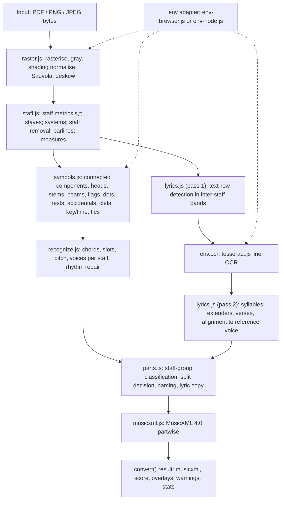

# Software Design Document: Scanned Sheet Music to MusicXML (browser OMR)

Version 0.9, 2026-11-08. Status: draft written before the design phase has finished. Where a later document
(`docs/DESIGN.md`, `docs/spike-*.md`, `docs/proposal-*.md`) has not been written yet, the open choice is marked
**To be decided by the design phase** and the candidates are listed. Nothing here reports a measured result
that the research documents do not already contain. When this SDD and `docs/DESIGN.md` disagree on a module
contract, `docs/DESIGN.md` wins and this document should be updated.

Sources used: `docs/research-omr.md` (cited as **[OMR §n]**), `docs/research-voices.md` (**[VOI §n]**), the
orchestration workflow `scan-pdf-to-musicxml` (**[WF]**), and the corpus as it stands on disk
(`corpus/real/`, `corpus/synthetic/_tools/`).

## 1. Introduction

### 1.1 Purpose

This document describes the design of a client-side web application that converts **scanned** sheet-music PDFs
(pages that are images, such as IMSLP, CPDL or Internet Archive scans, photocopies and phone scans) into
**MusicXML 4.0 `score-partwise`**. It is written for the people and agents who build, review and test the
system, and it fixes the module boundaries, data shapes, algorithms and acceptance criteria they work to.

### 1.2 Scope

In scope:

- Image-only PDFs, plus PNG and JPEG page images. Born-digital vector PDFs are a secondary goal: they are
  rasterised and go through the same image path.
- Printed (engraved or typeset) Western staff notation. The primary repertoire is hymns and chorales in
  **closed score** (SATB on two staves with lyrics between them). Secondary: open-score SATB, a single melody
  with lyrics, voice and piano, and piano solo.
- Lyrics: OCR of the text rows, syllabification from the printed hyphens, extenders, several verses, and
  alignment to notes.
- Splitting several voices on one staff into separate `<part>`s when the staff is a vocal closed score, while
  keeping keyboard grand staves as one part with two staves.
- A node harness that runs the same core against a ground-truth corpus and reports accuracy.

Out of scope for v1: handwritten music, tablature, early (mensural or chant) notation, chord symbols and
figured bass, dynamics and articulations beyond fermatas, editing the recognised score inside the app, and
any server-side processing.

### 1.3 Definitions

| Term | Definition |
|---|---|
| Staff space (`s`) | Distance between the centres of two adjacent staff lines, in pixels. All geometric thresholds are expressed in `s`. |
| Line thickness (`t`) | Thickness of a staff line in pixels, the most frequent vertical black run [OMR §2.4]. |
| Staff position (`pos`) | Vertical position of a notehead in half staff spaces relative to the middle line; positive is up. Line 3 (middle) is 0, the top line is +4, the bottom line is −4. |
| Staff | Five lines, modelled as one polyline per line. |
| System | The staves that are played together and read left to right before the next line of music; joined by a brace, a bracket, a left-edge line or barlines running through the gap. |
| Staff group | Staves inside a system joined by one brace or bracket [VOI §1]. |
| Logical part | One performer or section followed across systems and pages [VOI §1]. |
| Closed score | Two or more vocal parts sharing a staff, typically S+A on a treble staff and T+B on a bass staff [VOI §1, §3]. |
| Open score | One staff per vocal part. |
| Grand staff | Two staves braced for one keyboard player. Never split into parts. |
| Divisi | One section temporarily divided into two lines, often on one staff [VOI §4]. |
| Voice | A monophonic sequence of events in time within a staff; MusicXML `<voice>` [VOI §1]. |
| Slot | The set of events on a system that share an onset and are roughly x-aligned [VOI §1]. |
| Unison (shared head) | One notehead sung by two voices, drawn with a stem on each side or as a single stem with no opposite-stem event [VOI §2.2]. |
| Syllabic | MusicXML lyric attribute: `single`, `begin`, `middle` or `end`, from the syllable's place in its word. |
| Extender | A horizontal line after a word's last syllable showing that the syllable is held over several notes (melisma); MusicXML `<extend>`. |
| Melisma | One syllable sung over several notes. |
| Verse | One lyric line; MusicXML `<lyric number="n">`. |
| Divisions | MusicXML ticks per quarter note, set per part in `<attributes>`. |
| Backup / forward | MusicXML elements that move the time cursor back or forward so several voices can be written in one part. |
| OMR-NED | (I + D) / (N_pred + N_ref) over visual symbols, a substitution counting as one deletion plus one insertion; built on musicdiff, from the Sheet Music Benchmark, ISMIR 2025 [OMR §8]. Lower is better. |
| TEDn | Normalised tree edit distance on MusicXML (Hajič et al. 2016) [OMR §8]. |
| SER / CER | Symbol and character error rates: edit distance divided by reference length. |
| MV2H | Joint multi-pitch, voice, meter, value and harmony score (McLeod & Steedman 2018). Its voice component measures part splitting [OMR §8]. |
| Artifact | A page published on claude.ai: one HTML file plus supporting files, under a strict Content Security Policy. |

## 2. Requirements

### 2.1 Functional requirements

| ID | Requirement |
|---|---|
| F1 | Accept a PDF (image-only or vector), PNG or JPEG by drag-and-drop or file picker. Multi-page PDFs are processed page by page. |
| F2 | On first open, convert a bundled public-domain scanned closed-score SATB hymn with lyrics, so the page opens in a working state. |
| F3 | Detect staves, systems, staff groups, barlines and measures on each page. |
| F4 | Recognise noteheads (filled, hollow, whole), stems, beams, flags, augmentation dots, rests, accidentals, clefs, key and time signatures, ties, ledger lines, fermatas and repeat barlines. Tuplets with a printed number are in scope; unmarked tuplets are handled by rhythm repair. |
| F5 | Produce pitch (clef, key, accidentals, octave clefs) and duration for every note, with chords and voices per staff. |
| F6 | Make every voice in every measure sum to the measure length, or pad it and flag the measure. |
| F7 | OCR lyric rows, split them into syllables with the correct `syllabic`, detect extenders and verse numbers, and attach syllables to notes. |
| F8 | Decide per logical staff group whether to split voices into separate parts (closed score) or keep them (keyboard, ambiguous), using the procedure in §6. Copy lyrics to every voice that sings them (§7). |
| F9 | Name parts from OCR'd system-start labels, or infer names from layout, and mark inferred names. |
| F10 | Emit MusicXML 4.0 `score-partwise` that validates against the official XSD, with `<part-group>`, `<divisions>`, `<voice>`, `<backup>`/`<forward>`, `<staff>`, `<lyric>`, and `implicit="yes"` on pickup measures. |
| F11 | Show the scanned page with a toggleable overlay of detections, a notation preview of the result, a per-part summary (including which parts were split from shared staves), a lyrics preview, warnings with confidence, progress per stage, and the MusicXML in a selectable text area with a Copy button. |
| F12 | Let the user override an ambiguous split decision with a toggle (§6.5), and re-emit MusicXML without re-running recognition. |
| F13 | The same core runs in node for the accuracy harness. |

### 2.2 Non-functional requirements

**Accuracy targets.** The v1 targets come from the research recommendations and are not yet measured:

| Measure | Target | Source |
|---|---|---|
| Note F1 (onset, pitch, duration) on clean synthetic closed-score hymns | ≥ 95 % | [OMR §9.4] |
| Part assignment (share of truth notes in the right S/A/T/B part), clean synthetic | ≥ 97 % | [OMR §9.4] |
| Lyric syllable-to-note attachment, clean synthetic | ≥ 90 % | [OMR §9.4] |
| Voice assignment with ground-truth symbols (isolates the voice logic) | ≥ 99 % of notes in the correct voice on chorales | [VOI §12] |
| Split decision per staff group, hymns and Lieder | 100 % | [VOI §12] |
| XSD validity of output | 100 % of outputs | §10 |
| Crashes over the corpus | 0 | [WF] |
| Degraded synthetic and real scans | Reported separately; thresholds **to be decided by the design phase** once the spikes report numbers | — |

For context, the best open system reports OMR-NED of 11.1–11.2 % on quartet scans and 17.0–17.8 % on Lieder
scans for its 2M-parameter model (copisteria, *self-reported*), and Audiveris 5.11 reports 66.9 % and 51.8 %
on the same sets [OMR §3.2]. No published system produces lyrics and voice-separated parts together
[OMR §0].

**Performance.** Budget per 300 dpi page on a mid-range laptop, single-thread WASM [OMR §7.4] (estimates to be
verified by the harness):

| Stage | Budget |
|---|---|
| Classical image stages (binarise to symbol assembly) | 0.3–1.5 s |
| Lyric OCR, tesseract fast model | 0.1–0.3 s per row; 2–5 s for a hymn page with 4 systems and 3–4 verses |
| Optional tiny CNN classifier on a few hundred crops | < 0.5 s |
| Optional 2M-parameter detector at 1536 px long side | 1–3 s |
| Whole page, v1 (no ML) | target ≤ 8 s; hard ceiling 20 s before a "this page is slow" notice |

Heavy work runs off the main thread in a same-origin Web Worker, so the UI stays responsive. Peak memory for
one 300 dpi A4 page (about 8.7 Mpx) should stay below 300 MB: gray, binary and staff-removed copies are
`Uint8Array`s, and the integral images are `Float64Array`s that are freed after binarisation.

**Size budget.** Each supporting file ≤ 15 MB, the total ≤ 64 MB [WF]. Planned: phase 1 about 13–20 MB, phase
2 with ONNX about 30–40 MB [OMR §9.3]. The build fails if a limit is exceeded (§9).

**Licensing.** Everything shipped must be open source and compatible with public distribution: MIT, Apache-2.0,
BSD or OFL. Nothing AGPL, GPL, LGPL or non-commercial is shipped (§11).

**Accessibility.** WCAG 2.2 AA for the page: keyboard operation of every control, visible focus, text contrast
≥ 4.5:1, an `aria-live` progress region, no information carried by colour alone (voice overlays also differ
by marker shape and are listed in text), `prefers-reduced-motion` respected, and a usable layout at 400 px
width with no horizontal page scroll (§8.5).

**Privacy.** The user's file never leaves the browser. There are no network requests after the page and its
assets have loaded.

**Portability.** Current Chrome, Edge, Firefox and Safari. No `SharedArrayBuffer` and no
`crossOriginIsolated` requirement.

## 3. Architecture overview

### 3.1 Pipeline

The core is a pure function from page bitmaps to a score model and MusicXML. It holds no DOM references.
Environment-specific work (PDF rasterising, image decoding, OCR engines, ONNX sessions) is reached through an
injected **environment adapter**.



Each arrow is a typed data structure defined in §5. Stages are run per page by `index.js`, except
`recognize` (cross-system part continuity), `parts` (piece-level decisions) and `musicxml`, which run once over
all pages.

### 3.2 Module layout

The layout is fixed by the build workflow, with one owner per file [WF]:

| File | Responsibility |
|---|---|
| `src/raster.js` | Input bytes to page bitmaps via the env adapter; gray, binarise, deskew, denoise, scale normalisation. |
| `src/staff.js` | Staff lines, staff space and thickness, systems and staff groups, staff removal, barlines, measures. |
| `src/symbols.js` | Symbol detection and classification; model loading through env. |
| `src/recognize.js` | Symbols to score model: pitch, duration, chords, voices per staff, rhythm repair, cross-system continuity. |
| `src/lyrics.js` | Lyric strip location, OCR through env, syllables, extenders, verses, alignment, voice assignment. |
| `src/parts.js` | Split decision, part naming, lyric duplication policy. |
| `src/musicxml.js` | Score model to XSD-valid MusicXML 4.0. |
| `src/index.js` | `convert(input, {env, onProgress, options})`; stage orchestration, timing, error containment. |
| `src/env-node.js`, `src/env-browser.js` | Environment adapters. |
| `ui/template.html`, `ui/ui.js`, `ui/styles.css` | The page. |
| `build.mjs` | Bundles to `dist/index.html` (all app JS inlined) and `dist/assets/`, enforces size limits. |
| `test/run.mjs`, `test/schema/` | Harness and MusicXML 4.0 XSD. |

### 3.3 Environment adapters

```text
interface Env {
  name: 'browser' | 'node'
  rasterize(bytes: Uint8Array, opts: {targetDpi?: number, maxPixels?: number})
      -> AsyncIterable<{pageIndex, bitmap: Bitmap, sourceDpi: number | null, isImageOnly: boolean}>
  decodeImage(bytes: Uint8Array, mime: string) -> Promise<Bitmap>
  createOcr(opts: {langs: string[]}) -> Promise<OcrEngine | null>
  createOnnxSession(modelName: string) -> Promise<OnnxSession | null>   // null when not shipped
  now() -> number                                                       // ms, for stats
  yield() -> Promise<void>                                              // lets the UI breathe
}
interface OcrEngine {
  recognizeLine(bitmap: Bitmap, opts: {whitelist?: string, psm?: 7})
      -> Promise<{text, conf, words: [{text, conf, bbox: [x0,y0,x1,y1]}]}>
  terminate() -> Promise<void>
}
```

| Concern | Browser (`env-browser.js`) | Node (`env-node.js`) |
|---|---|---|
| PDF | pdf.js 3.11.174 from cdnjs as plain `<script>` tags, worker script also as a tag so pdf.js runs its fake worker on the main thread [OMR §7.3]. For image-only pages render at the embedded image's native resolution; otherwise about 300 dpi. | `pdfimages -png` for embedded scans at native resolution, `pdftoppm -r 300 -gray` for vector pages [OMR §2.1]; decode with pngjs. |
| Images | `createImageBitmap` → `OffscreenCanvas` → `getImageData` → gray. | pngjs / jpeg decoder. |
| OCR | tesseract.js 7.0.0 with `workerPath`, `corePath` (a directory), `langPath` all relative to `assets/`, `workerBlobURL: false`, `gzip: false` [OMR §6.2]. | tesseract.js in node with the same traineddata. |
| ONNX (optional) | onnxruntime-web 1.30.0 script from cdnjs; `ort.env.wasm.wasmPaths = 'assets/'` (or `wasmBinary` from a decompressed `.wasm.gz`); `numThreads = 1`; no proxy worker [OMR §7.1]. | onnxruntime-node, same `.onnx` files. |

The core never imports either adapter. `index.js` receives one as an argument, which makes the harness and the
browser run byte-identical core code.

### 3.4 Threading

The browser runs the core in one same-origin module worker (`assets/omr-worker.js`, or a `blob:` worker built
from the inlined bundle). pdf.js runs on the main thread (fake worker) and transfers page bitmaps to the OMR
worker as `ArrayBuffer`s. Tesseract runs in its own worker created by tesseract.js. ORT runs single-threaded
inside the OMR worker. Progress events are posted back to the UI thread.

### 3.5 Error containment

Every stage is wrapped by `index.js`. A stage that throws on one page or one system yields an empty result for
that unit plus a `warning` of severity `error`, and the pipeline continues. `convert()` returns partial MusicXML
whenever at least one measure was recognised. Only input-level failures (unreadable file, encrypted PDF, zero
pages) end the run with an error state.

## 4. Module design

Each module lists its responsibility, inputs and outputs, algorithms, failure modes and confidence.
Thresholds are written in staff spaces `s` and line thickness `t`, and are starting values for tuning on the
corpus.

### 4.1 raster.js

**Responsibility.** Turn input bytes into normalised page images: gray, binary, deskewed, at a scale where
`s` is in a workable range.

**Inputs/outputs.** `Uint8Array` + MIME → `Page[]` (§5.1) holding `gray`, `binary`, `skewDeg`, `scale`
(working pixels per source pixel) and the transform back to source coordinates.

**Algorithms.**

1. **Rasterise** through `env.rasterize` or `env.decodeImage`. Reject pages above 40 Mpx with a warning and
   downscale them to 40 Mpx.
2. **Gray**: luminance `0.299R + 0.587G + 0.114B`, or the single channel when already gray.
3. **Shading normalisation**: estimate the background with a large-kernel blur (about 1/20 of the page width)
   or a morphological closing, and divide it out. Run line detection on both the original and the normalised
   copy and keep whichever yields more consistent staves, as copisteria does [OMR §2.2].
4. **Binarise with Sauvola**: `T(x,y) = m·(1 + k·(σ/R − 1))`, R = 128, k = 0.2–0.4, window about 2–4 `s`
   (31–61 px at 300 dpi), computed in O(1) per pixel from integral images of I and I² (Shafait, Keysers &
   Breuel 2008) [OMR §2.2]. Before `s` is known, use a 41 px window, then re-run with a window of 3 `s` once
   staff metrics exist. Compute **Otsu** as well and keep the image whose vertical run-length histogram gives
   the sharper `t+s` peak.
5. **Deskew**: maximise the variance of the horizontal projection profile over angles in ±5°, coarse 0.5°
   steps, then refine to 0.05° [OMR §2.3]. Rotate gray and binary with bilinear sampling. Local curvature is
   not dewarped here; `staff.js` models it with polylines.
6. **Denoise**: remove connected components of area below `0.02 s²` that do not touch a staff line
   (salt-and-pepper), after `s` is known.
7. **Scale normalisation**: if `s < 10 px`, upscale the page 2× before recognition [OMR §9.5]; if `s > 40 px`,
   downscale towards 20 px. Rule-based steps do best around `s` = 16–24 px [OMR §2.1].

**Failure modes.** Very dark or very light scans (Sauvola leaves speckle or erases thin lines); colour scans
with red rubrics; 2-up landscape pages; strong gutter curvature; pages with no music (title pages).
**Confidence.** `rasterConf` = sharpness of the staff-line run-length peak, normalised to [0,1]; low values
add a warning ("faint or noisy scan").

### 4.2 staff.js

**Responsibility.** Staff metrics, staves as line polylines, systems and staff groups, staff removal,
barlines and measures.

**Inputs/outputs.** `Page` → `StaffLayout` (§5.2, §5.3): `staves[]`, `systems[]`, `measures[]`, `s`, `t`,
plus a staff-removed binary image `noStaff`.

**Algorithms.**

1. **Run-length staff metrics.** Over all columns, histogram vertical black runs (mode = `t`) and white runs
   (mode ≈ `s − t`). Following Cardoso & Rebelo (ICPR 2010), take the most common sum of a black run and the
   following white run as `t + s`, which is robust when one of the two histograms is noisy [OMR §2.4].
2. **Projection-based staff detection per strip.** Split the page into 8–16 vertical strips. In each strip,
   take the horizontal black projection, find peaks, and group peaks into runs of **five** lines spaced
   `t + s` ± 20 % [OMR §2.5]. Link five-line groups across adjacent strips by vertical overlap, which tolerates
   skew and curvature. Fit each line as a polyline through the strip centres.
3. **Line tracking fallback.** Where strips disagree (curved pages, broken lines), track each line column by
   column, following the black run nearest the predicted y; as a second fallback, use stable shortest paths
   (Cardoso et al., TPAMI 2009) [OMR §2.5].
4. **Staff removal.** Along each tracked line, delete black pixels whose vertical run through the line is at
   most about `1.75 t` and is centred on it; keep longer runs because they belong to symbols (Dalitz et al.,
   TPAMI 2008, "line track height") [OMR §2.6]. Keep the un-removed gray and binary images for notehead
   matching, because removal fragments hollow heads.
5. **Barlines.** In the staff-removed image, find vertical runs of width ≤ `0.4 s` that span the staff from the
   top line to the bottom line (± `0.5 s`) and have no notehead attached. Classify thin, thick, double, final
   and repeat (two dots in spaces 2 and 3 next to a thick-thin pair).
6. **Systems and staff groups.** Two vertically adjacent staves belong to one system when a brace, bracket or
   vertical ink run joins them at the left edge, or when barlines continue through the gap [OMR §2.5].
   Classify the left-edge glyph: a **brace** is a tall curly component of width about 1–1.5 `s`; a **bracket**
   is a thick vertical bar with serifs at both ends. Record `groupSymbol: 'brace' | 'bracket' | 'line' | 'none'`.
7. **Measures.** Within each system, barlines that are present on every staff (or span the system) cut it into
   measures. A barline found on only some staves is kept only if it is consistent with the system's other
   barlines; otherwise it is reported as a candidate for `recognize.js` repair.

**Failure modes.** Staves that touch text or ornaments; lyric hyphens or extenders read as staff fragments;
partial staves (ossia, cue staves); systems split across a gutter; very short systems (codas); barlines
merged with stems in dense music. **Confidence.** Per staff: regularity of line spacing (coefficient of
variation of the five gaps) and line coverage across the width; per system: group-symbol detection score.

### 4.3 symbols.js

**Responsibility.** Find and classify music symbols on each staff and attach a confidence to each.

**Inputs/outputs.** `Page` + `StaffLayout` → `Symbol[]` (§5.4) in page coordinates, each with staff index,
`pos` (for heads, rests, dots and accidentals), class, bbox and confidence; plus a list of text-like
components handed to `lyrics.js`.

**Algorithms.**

1. **Connected components.** Two-pass union-find with 8-connectivity on `noStaff`, recording bbox, area,
   centroid, density and moments in `s` units. A second pass on the inverted image inside each component's
   bbox finds enclosed holes (hollow heads, whole notes, flats, sharps, naturals) [OMR §2.7].
2. **Text separation.** Components outside the staff band (more than about 1.5 `s` above the top line or below
   the bottom line, excluding ledger-line regions) whose height is about 0.6–1.2 `s` and which line up on a
   common baseline are marked as text and masked out of music recognition [OMR §2.7].
3. **Noteheads.** Normalised cross-correlation of templates against the **gray, un-removed** image at the
   normalised `s`, restricted to staff positions (line or space, half-space quantisation) [OMR §2.8]. Templates
   for filled, hollow and whole heads (2–3 variants each) are rendered from Bravura or Leland (SIL OFL-1.1).
   Peaks above threshold, after non-maximum suppression, become head candidates. Hollow versus filled is
   checked by the hole test. Heads on ledger lines are found by extending the position grid above and below
   the staff where short horizontal runs of length about 1.5–2 `s` exist.
4. **Stems.** Vertical runs of length ≥ about 2.5 `s` and width ≤ about 0.3 `s` touching a head: stem at the
   head's right edge means stem up, at its left edge stem down. A head with stems on both sides, or a head
   with an up stem and a down stem, is marked `stemDir: 'both'` (a unison of two voices) [OMR §2.9; VOI §2.2].
   A single stem with heads at both ends or a head at its middle is tested as two aligned stems (the known
   merge failure [VOI §2.7]).
5. **Beams.** After stems are removed from compound components, thick near-horizontal bands (height about
   0.4–0.6 `s`) between stem ends. The number of beam lines crossing a stem gives the beam level (1 = eighth,
   2 = sixteenth). **Flags** are separate components at the free end of a stem [OMR §2.9].
6. **Augmentation dots.** Small round components about 0.5–1 `s` right of a head, in a space; a dot for a head
   on a line sits in the space above. Dots above or below a head on the stem-free side are staccato and are
   ignored in v1 [OMR §2.9].
7. **Rests, accidentals, clefs, digits.** Template matching or a small feature classifier (zoned density,
   aspect ratio, hole count, Hu moments) on component crops [OMR §2.8]. Key signature = accidentals between the
   clef and the first note or time signature; time signature = stacked digits or the C / cut-C glyph.
8. **Ties and slurs.** Thin curved components whose ends lie near two heads. A curve between two heads at the
   same pitch is a tie, otherwise a slur [OMR §2.9]. Fermatas by template.
9. **Optional ML assist** behind the same output contract: a tiny CNN on component crops, or a full-page
   detector. **To be decided by the design phase**, candidates:
   - classical only (NCC templates plus feature classifier);
   - tiny CNN on 32×32 crops, 50–200k parameters, int8 ONNX about 0.1 MB, trained on LilyPond-rendered crops
     and DeepScoresV2 (CC BY 4.0) [OMR §2.8, §9.4];
   - copista-2m detector (Apache-2.0, 1.94M parameters, 7.8 MB fp32 .pt; needs ONNX export; predicts stem
     direction including `both` and a voice slot per head) used as an extra vote [OMR §3.1, §9.4];
   - oemer UNets (MIT; 70.8 MB and 38.4 MB fp32, need quantisation and chunking) [OMR §3.1].
   The numbers that decide this will come from `docs/spike-ml.md` and `docs/spike-classical.md`, which have not
   been written yet.

**Failure modes.** Heads touching each other (seconds, unisons offset sideways); stems broken by staff
removal; beams merged with slurs; accidentals touching heads; lyric hyphens read as ledger lines or ties
[VOI §2.7]; fermatas read as heads; verse numbers read as fingering. **Confidence.** Each symbol carries its
classifier score in [0,1]; heads also carry the NCC peak value and stems their length ratio.

### 4.4 recognize.js

**Responsibility.** Assemble symbols into notes, chords, rests and voices, assign pitch and duration, repair
rhythm per measure, and keep parts continuous across systems and pages.

**Inputs/outputs.** `Symbol[]` + `StaffLayout` for every page → `Score` draft (§5.10) with measures, voices
per staff, events with onsets and durations, and per-measure repair records.

**Algorithms.**

1. **Pitch.** Pitch = clef + staff position + key signature + accidentals in force in the measure. An
   accidental holds until the barline for that step and octave; ties carry it across the barline. A clef change
   applies from its x onwards. Octave clefs (G2 with an 8 below) set `octaveChange = −1` [OMR §2.11].
2. **Chords and slots.** A stem with its heads forms a chord. Heads with stems on both sides are split into two
   mirrored chords that share a slot. Stemless heads are grouped by x. Slots are built per system measure:
   a shared stem means the same slot; the same beam group on different stems means different slots; otherwise
   x overlap within about 0.6 `s` [VOI §10 step 2; Audiveris `SlotsRetriever` described in VOI §2.5].
3. **Voices per staff by stem direction.** Two keys, U (upper) and L (lower) [VOI §10 step 3]:
   - stem up → U, stem down → L; a beam group takes the majority direction of its stems;
   - on a staff classified as two-voice, a single-stem chord with two heads is split top → U, bottom → L;
     extra middle heads are flagged divisi and attached as a chord to the nearer voice;
   - a single-stem single head with no opposite-stem event overlapping its span is a unison and is copied to
     both voices;
   - stemless heads: two in one slot go by pitch order; one goes to the voice that has no event in that span,
     else to both;
   - rests: ≥ +1 `s` above the middle line → U, ≤ −1 `s` below → L, centred → shared unless one voice already
     covers that time; a rest inside a beam group takes the beam's voice [VOI §2.3];
   - ties and beams keep their voice.
   Keyboard staves use the same steps without de-combining chords, with up to four voices per staff. Stem
   direction overrides pitch order, which preserves the 0.24 % (S/A) and 0.78 % (T/B) of slots where Bach
   chorale voices cross [VOI Appendix A].
4. **Duration hypotheses.** Each note gets a short list of hypotheses: head type × beam/flag count × dot
   present × tuplet membership, each with a prior from symbol confidence.
5. **Rhythm repair as constraint search.** Per staff and measure, choose one hypothesis per event and one
   resolution per ambiguous voice decision (shared or private rest, unison copy, divisi placement) so that:
   - **hard**: every voice's durations sum to the measure length (or to the pickup length in the first
     measure); onsets never decrease with x; events in one slot share an onset (Jin & Raphael's coincidence
     constraint [VOI §2.6]);
   - **soft**: maximise the summed log-confidence of the chosen hypotheses, penalise gaps, overlaps and onsets
     that are far from their x-column.
   Implementation: depth-first branch-and-bound ordered by confidence, with a budget of 200 states per measure
   [VOI §10 step 4]. Hymn measures have at most about 16 notes per voice, so exhaustive search inside the budget
   is cheap [OMR §2.10]. copisteria solves the same problem with a Viterbi search over 48ths of a quarter
   [OMR §2.10]; that remains the alternative if branch-and-bound proves too slow. The point of the search is
   that "one misread duration does not shift the rest of the bar".
6. **Missing barlines.** If a voice holds ≥ 1.75 bars of duration, look for a full-height vertical stroke near
   the point where the running sum crosses one bar, insert a barline and decode again [OMR §2.10].
7. **Time signature inference.** When none is printed, choose the bar length that the largest number of
   measures fit. Pickup: allow the first measure to be short and mark it `implicit`; in hymns the pickup and the
   final measure usually add up to one full measure [OMR §2.10].
8. **Fallback.** If no assignment satisfies the hard constraints within the budget, keep the best soft
   solution, pad each short voice with a `<forward>` (or an invisible rest), and flag the measure with
   confidence < 0.5 [VOI §11].
9. **Cross-system continuity.** Collate staff groups across systems into logical groups by staff count,
   clefs and labels; carry key, time and clef state forward; a system where a group is missing yields rests.

**Failure modes.** Missed dots and beams (the classic desynchronisation), unmarked triplets (copisteria gets
65 % of tuplet notes right when marks are removed against 96 % with them [OMR §2.10]), merged aligned stems,
grace notes, cross-staff beams. **Confidence.** Per measure: 1.0 if the measure passed without repair, reduced
by the cost of the repair, < 0.5 if padded. Per voice: share of its measures that passed without repair.

### 4.5 lyrics.js

**Responsibility.** Find lyric rows, OCR them, split into syllables, assign verses and `syllabic`, detect
extenders, and align syllables to the reference voice's onsets. Detail in §7.

**Inputs/outputs.** Pass 1: `Page` + `StaffLayout` + text components → `LyricRow[]` (bands with bboxes and
verse order). Pass 2: rows + `env.ocr` + `Score` draft → `LyricLine[]` of `Syllable` (§5.9) bound to slots of
a reference voice, with conflict counts per receiving voice.

**Algorithms** (summary; §7 has the full design): text-row detection by horizontal projection of masked small
components; crop with 0.3 `s` margin and upscale to x-height ≥ 20 px; tesseract single-line mode
(`tessedit_pageseg_mode = 7`) with word boxes; verse numbers stripped; hyphen and gap tokenisation;
geometric extender detection; monotonic DP alignment of syllables to onsets [OMR §6.3; VOI §7.2].

**Failure modes.** One-letter syllables ("a", "O") missed by OCR [OMR §3.3]; hyphens dropped; italic refrains;
lyric rows touching low notes or ledger lines; verses 4 and later printed as stanzas below the music, which
are not underlay [OMR §6.3]. **Confidence.** Per syllable: OCR word confidence × alignment cost factor; per
part and verse: coverage (syllables attached / syllables OCR'd).

### 4.6 parts.js

**Responsibility.** Classify each logical staff group, decide whether to split voices into parts, name the
parts, apply the lyric copy policy, and record provenance. Detail in §6.

**Inputs/outputs.** `Score` draft + `LyricLine[]` + label OCR → final `Part[]` (§5.8) with `splitFrom`
provenance, names (read or inferred), part groups and per-part confidence.

**Algorithms.** The weighted vocal-score classifier and thresholds of [VOI §5], the decision procedure of
[VOI §11], the naming procedure of [VOI §6], and the lyric copy rules of [VOI §7.2].

**Failure modes.** A hymn wrongly kept as one keyboard part; a piano accompaniment wrongly split; part count
changing between systems; labels misread. **Confidence.** Per part: the minimum of classification confidence
(sigmoid of the vocal score), voice-assignment confidence and stem-detection confidence [VOI §11].

### 4.7 musicxml.js

**Responsibility.** Serialise the final score model as XSD-valid MusicXML 4.0 `score-partwise`.

**Inputs/outputs.** `Score` → string. Pure and deterministic: the same input gives byte-identical output.

**Algorithms.**

1. **Divisions.** Internal durations are integer ticks at 48 per quarter (§5.5). Per part, `divisions` =
   48 / gcd(48, all durations in the part); written in the first measure's `<attributes>` and only re-written
   if it changes.
2. **Part list.** `<part-list>` with `<part-group type="start" number="n">` (group-name, `group-symbol`
   `bracket` for a split choir or `brace` for a keyboard part, `group-barline yes`), one `<score-part>` per
   part with `<part-name>` and `<part-abbreviation>`, and the matching `type="stop"` [VOI §8].
3. **Attributes.** Key (`<fifths>`, `<mode>` when known), time (`<beats>`, `<beat-type>`, or `symbol="common"`
   / `"cut"`), clefs (with `number` for multi-staff parts), `<staves>2</staves>` for grand staves. Split tenor
   parts use treble-8 (`G`, line 2, `clef-octave-change −1`) by default, with an option to keep the printed
   bass clef [VOI §8.1].
4. **Voices.** For each measure, write voice 1's events in order, then `<backup>` by the summed duration
   written so far, then voice 2, and so on. `<backup>` never crosses a measure boundary and its duration is
   positive [VOI §8]. Voice numbering on multi-staff parts: 1–4 for voices starting on staff 1, 5–8 on staff 2
   [VOI §0 item 5]. Every note in a multi-staff part carries `<staff>`.
5. **Notes.** `<pitch>` (step, alter, octave) or `<rest/>` (with `measure="yes"` for whole-measure rests),
   `<duration>`, `<tie type>` plus `<notations><tied>`, `<voice>`, `<type>`, `<dot/>`, `<time-modification>`
   for tuplets, `<stem>` only in unsplit multi-voice parts, `<chord/>` for the second and later heads of a
   chord, `<accidental>` when printed, `<notations><fermata/>`. Padding uses `<forward>` with `<voice>`, or a
   rest with `print-object="no"`.
6. **Lyrics.** `<lyric number="v">` with `<syllabic>`, `<text>`, optional `<elision>`, and `<extend
   type="start|stop"/>`; melisma continuation notes get no lyric element [VOI §8].
7. **Measures.** `number` sequential from 1 (0 for a pickup), `implicit="yes"` on pickups, `<barline>` for
   repeats, double and final bars. `<print new-system="yes">` and `new-page="yes"` mirror the scan's layout.
8. **Escaping and identity.** XML-escape all text; `<identification><encoding>` with software name and date;
   `<work-title>` from OCR of the largest text block on page 1 if confident, otherwise the file name.

**Failure modes.** Voice durations not matching after an upstream bug (guarded: the writer re-checks each
voice sum and inserts `<forward>` with a warning rather than writing an inconsistent measure); invalid
character data from OCR (stripped of control characters). **Confidence.** Not applicable; validity is
checked in the harness with `xmllint` against the 4.0 XSD.

### 4.8 index.js

`convert(input, {env, onProgress, options}) → {musicxml, score, pages: Overlay[], warnings, stats}`.
Runs stages in order, reports progress as `{stage, page, pageCount, fraction}`, records per-stage timings,
contains errors (§3.5), and exposes `reemit(score, overrides)` so the UI can toggle a split decision and get
new MusicXML without re-running recognition.

## 5. Data design

Conventions:

- **Coordinates** are in working-image pixels, origin top left, x right, y down, unless named `src*` (source
  image pixels). Each page stores the affine transform from working to source pixels for the overlay.
- **Sizes and distances** inside music logic are in staff spaces `s` unless the field name ends in `Px`.
- **Staff position** `pos`: half staff spaces from the middle line, positive up (§1.3).
- **Time**: integer ticks, `TPQ = 48` ticks per quarter note. 48 covers dotted values down to 32nds and
  triplets down to 16th triplets; quintuplets and finer tuplets would need a change of `TPQ` (**to be decided
  by the design phase** if the corpus contains them).
- **Confidence**: number in [0,1] on every recognised object, field `conf`.
- **IDs**: strings, unique within the score, prefixed by type (`st3`, `sy1`, `h204`, `n88`).
- The shapes below are JSON with `//` comments added for reading; a string such as `"Bitmap"` or `"up | down"`
  names a type or lists the allowed values, and `x0, y0` placeholders stand for numbers.

### 5.1 Bitmap and page

```json
// Bitmap: the only image type that crosses module boundaries
{ "width": 2480, "height": 3508, "data": "Uint8ClampedArray(width*height), 0 = black, 255 = white" }

// Page
{
  "index": 0,
  "gray": "Bitmap",
  "binary": "Bitmap (0 = ink, 255 = paper)",
  "noStaff": "Bitmap | null (set by staff.js)",
  "srcWidth": 2550, "srcHeight": 3300, "sourceDpi": 300,
  "skewDeg": -0.35,
  "scale": 1.0,
  "toSource": [1, 0, 0, 1, 0, 0],
  "binarization": "sauvola | otsu",
  "conf": 0.92
}
```

### 5.2 Staff

```json
{
  "id": "st3", "page": 0, "system": "sy1", "indexInSystem": 0,
  "lines": [[[120, 402.0], [600, 401.2], [2380, 399.8]], "... 5 polylines, top line first"],
  "s": 21.4, "t": 2.6,
  "x0": 118, "x1": 2382,
  "clefAtStart": { "sign": "G", "line": 2, "octaveChange": 0 },
  "lineCountDetected": 5,
  "conf": 0.97
}
```

### 5.3 System, staff group, barline, measure

```json
// System
{
  "id": "sy1", "page": 0, "staves": ["st3", "st4"],
  "groups": [{ "id": "g1", "staves": ["st3", "st4"], "symbol": "brace | bracket | line | none", "conf": 0.8 }],
  "barlines": [{ "id": "bl7", "x": 640, "kind": "single | double | final | repeat-start | repeat-end", "staves": ["st3", "st4"], "conf": 0.95 }],
  "measures": ["m1", "m2", "m3"],
  "labels": [{ "text": "S. A.", "bbox": [20, 380, 100, 440], "staff": "st3", "conf": 0.7 }]
}

// Measure (geometric span, shared by all staves of the system)
{ "id": "m2", "system": "sy1", "number": 2, "x0": 640, "x1": 1180,
  "pickup": false, "timeTicks": 192, "repair": null, "conf": 1.0 }
```

### 5.4 Symbol

```json
{
  "id": "h204", "page": 0, "staff": "st3",
  "kind": "head | stem | beam | flag | dot | rest | accidental | clef | keySig | timeSig | tie | slur | ledger | fermata | barline | text",
  "subtype": "filled | hollow | whole | quarter-rest | eighth-rest | sharp | flat | natural | G | F | C | 3 | ...",
  "bbox": [812, 371, 834, 391],
  "cx": 823, "cy": 381,
  "pos": 3,
  "stemDir": "up | down | both | none",
  "links": { "stem": "sm33", "dots": ["d9"], "accidental": "ac2", "beams": ["bm4"] },
  "conf": 0.88,
  "source": "ncc | features | cnn | detector"
}
```

### 5.5 Note, rest and chord

```json
// Note
{
  "id": "n88", "head": "h204",
  "pitch": { "step": "E", "alter": 0, "octave": 5 },
  "accidentalPrinted": null,
  "durTicks": 96, "type": "half", "dots": 0,
  "tuplet": null,
  "tie": { "start": false, "stop": false },
  "fermata": false,
  "lyrics": ["Syllable refs"],
  "conf": 0.9
}

// Rest
{ "id": "r12", "durTicks": 48, "type": "quarter", "dots": 0, "measureRest": false,
  "vertical": "up | down | centre", "shared": false, "hidden": false, "conf": 0.85 }

// Chord: one onset, one stem (or stemless group), one voice
{ "id": "c40", "staff": "st3", "onsetTicks": 0, "durTicks": 96,
  "notes": ["n88"], "stemDir": "up", "beamGroup": "bg5", "slot": "sl3",
  "mirrorOf": null, "copiedFrom": null, "conf": 0.9 }
```

### 5.6 Voice

```json
{
  "id": "v-st3-U", "staff": "st3", "key": "U | L | K1 | K2 | K3 | K4",
  "events": [{ "measure": "m2", "chord": "c40" }, { "measure": "m2", "rest": "r12" }],
  "unisonCopies": 3, "decombinedChords": 5, "divisiFlags": 0,
  "conf": 0.94
}
```

`U`/`L` are the upper and lower voices of a two-voice staff; `K1`–`K4` are keyboard voices.

### 5.7 Measure content (per staff group, after repair)

```json
{
  "measure": "m2", "group": "g1",
  "voices": {
    "v-st3-U": { "events": ["c40", "c41", "r12"], "sumTicks": 192, "padTicks": 0 },
    "v-st3-L": { "events": ["c42", "c43"], "sumTicks": 192, "padTicks": 0 }
  },
  "repair": { "applied": true, "states": 37, "changes": ["dot added to n91"], "cost": 1.6 },
  "conf": 0.78
}
```

### 5.8 Part

```json
{
  "id": "P2",
  "name": "Alto", "abbreviation": "A.", "nameSource": "label | inferred",
  "kind": "vocal | keyboard | instrument | unknown",
  "staves": 1,
  "clef": { "sign": "G", "line": 2, "octaveChange": 0 },
  "voices": ["v-st3-L"],
  "splitFrom": { "logicalGroup": "LG1", "staffIndex": 0, "voiceKey": "L", "stem": "down",
                 "reason": "lyrics between staves; opposite stems in 92% of bars", "vocalScore": 7.0 },
  "group": "PG1",
  "lyricSource": "copied | read | none",
  "conf": 0.86
}

// Part group
{ "id": "PG1", "name": "Choir", "symbol": "bracket | brace", "barline": true, "parts": ["P1", "P2", "P3", "P4"] }
```

### 5.9 Lyric row, line and syllable

```json
// LyricRow (pass 1, geometry only)
{ "id": "lr4", "system": "sy1", "aboveStaff": "st3", "belowStaff": "st4",
  "bbox": [130, 470, 2370, 505], "baselineY": 500, "xHeightPx": 13,
  "verseIndex": 1, "verseLabel": "1." }

// LyricLine (pass 2)
{ "id": "ll4", "row": "lr4", "verse": 1, "ocrText": "Praise God from whom all bless - ings flow",
  "ocrConf": 0.83, "syllables": ["sb51", "..."],
  "referenceVoice": "v-st3-U", "receivers": ["v-st3-U", "v-st3-L", "v-st4-U", "v-st4-L"],
  "conflicts": { "v-st3-L": 1, "v-st4-U": 0, "v-st4-L": 2 } }

// Syllable
{ "id": "sb51", "text": "bless", "syllabic": "begin", "verse": 1,
  "bbox": [1500, 478, 1560, 500], "cx": 1530,
  "extender": false, "elision": false,
  "slot": "sl14", "attachedTo": { "v-st3-U": "n120", "v-st3-L": "n121" },
  "conf": 0.79 }
```

### 5.10 Score

```json
{
  "meta": { "title": "Old Hundredth", "titleConf": 0.6, "source": "upload.pdf", "pages": 1,
            "software": "scan2mxl 0.1", "created": "2026-11-08" },
  "pages": ["Page"], "staves": ["Staff"], "systems": ["System"], "measures": ["Measure"],
  "symbols": ["Symbol"], "chords": ["Chord"], "notes": ["Note"], "rests": ["Rest"],
  "voices": ["Voice"], "measureContent": ["MeasureContent"],
  "logicalGroups": [{ "id": "LG1", "staffCount": 2, "systems": ["sy1", "sy2"], "classification": "vocal-closed | keyboard | ambiguous | single", "vocalScore": 7.0, "features": {} }],
  "parts": ["Part"], "partGroups": ["PartGroup"],
  "lyricLines": ["LyricLine"], "syllables": ["Syllable"],
  "key": { "fifths": 1, "mode": "major" }, "time": { "beats": 4, "beatType": 4, "symbol": null },
  "tpq": 48,
  "overrides": { "LG1": "auto | split | keep" }
}
```

### 5.11 Overlay

Geometry for the UI, in **source** pixels so it can be drawn over the original scan.

```json
{
  "page": 0, "width": 2550, "height": 3300,
  "layers": {
    "staves":   [{ "id": "st3", "polylines": [[[x, y], "..."]], "conf": 0.97 }],
    "systems":  [{ "id": "sy1", "bbox": [x0, y0, x1, y1], "groupSymbol": "brace" }],
    "barlines": [{ "x": 640, "y0": 380, "y1": 760 }],
    "heads":    [{ "bbox": [x0, y0, x1, y1], "part": "P2", "voiceKey": "L", "marker": "triangle-down", "conf": 0.88 }],
    "rests":    [{ "bbox": [x0, y0, x1, y1], "part": "P1", "conf": 0.8 }],
    "lyrics":   [{ "bbox": [x0, y0, x1, y1], "text": "bless", "verse": 1, "attached": true }],
    "flags":    [{ "bbox": [x0, y0, x1, y1], "measure": "m7", "reason": "padded", "severity": "warn" }]
  }
}
```

### 5.12 Warning

```json
{
  "code": "MEASURE_PADDED | LYRICS_NOT_COPIED | SPLIT_AMBIGUOUS | NAME_INFERRED | FAINT_SCAN | STANZA_TEXT_UNATTACHED | DIVISI_KEPT_AS_CHORD | STAGE_FAILED | LOW_DPI_UPSCALED | PAGE_NO_MUSIC",
  "severity": "info | warn | error",
  "message": "Lyrics not applied to Tenor: rhythm differs in 4 places",
  "where": { "page": 0, "system": "sy2", "measure": "m9", "part": "P3" },
  "conf": 0.4
}
```

## 6. Part-splitting decision procedure

### 6.1 Evidence from the research

- Stem direction is the primary evidence for voices on a printed staff; pitch is a fallback [VOI §0, §2.1].
- In 368 four-part Bach chorales from the music21 10.5.2 corpus [VOI Appendix A]:

| Pair | Slots | Unison | Crossing | Rhythm diverges | One voice resting |
|---|---|---|---|---|---|
| S/A | 24,381 | 2.46 % | 0.24 % | 31.76 % | 0.82 % |
| T/B | 27,182 | 3.58 % | 0.78 % | 30.58 % | 0.80 % |

  Consequences: unisons are common enough to need explicit copying; crossings are rare but real, so stem
  direction must win over pitch order; about 31 % of slots have an onset in only one voice, so lyric copying
  must align by slot, not by note index. Lyrics appear on the soprano only in 320 of the 368 files, so lower-voice
  lyric truth has to be derived [VOI §0].
- Consistency is the hard part: a greedy rule baseline gets only 55.1 % of piano measures with all voices
  matching, against 92.4 % for search guided by a model (BeadSolver, Table 7); Jin & Raphael's constrained
  graph search interprets 95.7 % of system measures correctly [VOI §0]. Closed hymns are easier, but the
  design uses the same tool: a hard bar-length constraint plus repair search (§4.4).

### 6.2 Vocal-score classifier

Computed per **logical** staff group, summed over all of its systems. Weights are the research
recommendation and are tuned on the corpus [VOI §5]:

| Feature | Weight |
|---|---|
| Vocal label tokens at system start (S, A, T, B, Soprano, Alto, Tenor, Bass, Sopran, Alt, Contralto, Basso, Cantus, Altus, Bassus, Women, Men, Choir, Chorus, Coro, Chor, SATB) | +3 |
| Lyric rows adjacent to the group (below staff 1 or between its staves) | +2.5 |
| Per staff: both stem directions co-occur in ≥ 30 % of measures | +1.5 per staff |
| ≥ 98 % of stems have ≤ 2 heads | +1 |
| Stream ranges fit SATB (S ≈ C4–A5, A ≈ F3–D5, T ≈ C3–G4, B ≈ E2–D4) | +1 |
| Treble-8 clef present | +0.5 |
| Bracket rather than brace | +0.5 |
| Keyboard label (Piano, Pno., Pf., Klavier, Organ, Org., Orgel, Manual, Ped., Harmonium, Harp, Accomp.) | −3 |
| Lyrics in the system, but only on a different staff | −2.5 |
| Pedal marks, arpeggio lines, fingering digits, cross-staff or kneed beams, 8va lines | −2 |
| ≥ 5 % of stems with ≥ 3 heads; octave doublings in the bottom stream | −1.5 |
| Brace and no lyrics anywhere near | −0.5 |

A brace alone must not veto a split, because hymnals often brace SA/TB staves so the short score can double
as an organ part [VOI §5]. A typical unlabelled hymn scores about +7; a song accompaniment about −7.

### 6.3 Rules

```text
for each logical staff group G (whole piece):
  s = vocalScore(G)
  if G.staves == 1:
     twoVoice = share of measures (where the staff has notes) with >= 2 concurrent streams
     names    = labelNames(G)
     if names.count >= 2 and (s >= 1 or twoVoice >= 0.2):    SPLIT into names
     elif twoVoice >= 0.5 and allStreamsMonophonic and s >= 3: SPLIT into "<Name> 1", "<Name> 2"
     else: KEEP one part, voices 1/2 (warn if twoVoice > 0)
  elif G.staves == 2:
     if s >= 3:   SPLIT: per staff k voices (k = max concurrent streams, usually 2; SAB gives 2+1)
     elif s <= -1: KEEP as keyboard part: <staves>2</staves>, voices 1-4 / 5-8
     else:        KEEP as closed score (two parts, voices 1/2) and flag SPLIT_AMBIGUOUS
  elif G.staves >= 3: KEEP (organ) unless every staff qualifies as vocal on its own
  part count is fixed for the piece; never split per measure;
  measures with fewer visible voices get unison copies or rests.
```

Source: [VOI §11]. Decisions are made once per logical group for the whole piece. Part layout is planned on
the fullest system and every other system is mapped onto it, so a system where a voice drops out still yields
the same parts, with rests [OMR §5.2 step 5].

### 6.4 Output forms

| Form | When | MusicXML |
|---|---|---|
| A: split choir | `s ≥ 3` | One `<score-part>` per voice inside `<part-group>` with `group-symbol bracket`, each part monophonic `<voice>1</voice>`, unisons and shared rests duplicated, lyrics copied [VOI §8.1]. |
| B: closed score kept | ambiguous band, or user choice | One part per staff with voices 1 and 2 and `<backup>`; lossless; split available as a toggle [VOI §8.2]. |
| C: keyboard | `s ≤ −1` | One part, `<staves>2</staves>`, `<staff>` on every note, voices 1–4 on staff 1 and 5–8 on staff 2 [VOI §8.3]. |

### 6.5 Ambiguous and edge cases

| Case | Action | User-facing note |
|---|---|---|
| Braced hymn staves, no labels, lyrics between staves | Split | "Split from shared staves: lyrics between staves, opposite stems in N % of bars" |
| Single-stem two-note chords through a passage of a closed staff | De-combine top/bottom | Silent unless a chord has ≥ 3 heads |
| ≥ 3 heads on a closed staff (local divisi) | Extra head stays a chord in the nearer voice | "Divisi in bar N kept as chord in Alto" |
| Two-voice texture on an open-score staff in < 50 % of bars, unlabelled | Keep one part with voices | "Soprano has divisi in bars …" |
| Voice count differs between systems | Use the maximum for the piece; fill with unison copies or rests | — |
| Lyric conflicts > 15 % of a verse's syllables for a voice | Do not copy that verse to that voice | "Lyrics not applied to Tenor (N conflicts)" |
| Bar fails after repair | `<forward>` padding, measure confidence < 0.5 | Bar highlighted in the overlay |
| Score in (−1, 3) | Output B, toggle offered | "Could be piano or choir: currently kept together" |
| Vocal score with piano reduction below | Choir group split, piano kept | "Piano reduction kept as one part" |
| Instrumental shared staff labelled "1.2" or "a2" | Keep unless labelled with two names and monophonic | "Flutes 1.2 kept as one part (two voices)" |

Source: [VOI §11]. The user toggle sets `score.overrides[LG] = 'split' | 'keep'` and calls `reemit`.

### 6.6 Naming

Label regions are text boxes left of the first barline that overlap a staff or sit centred on a group symbol.
They are normalised (lowercase, diacritics and punctuation stripped, split on whitespace, `/`, `&`, `,`, `+`,
`.`) and looked up in a multilingual lexicon (soprano, alto, tenor, baritone, bass, collectives such as
Women → S+A and Men → T+B, divisi markers, keyboard tokens). On a two-voice staff the first name goes to the
upper voice; four names on a two-staff group map (1,2) to staff 1 and (3,4) to staff 2. Abbreviations on later
systems are matched by prefix and never change the part count. Unlabelled vocal groups get S, A, T, B
(treble + bass), Tenor I, Tenor II, Baritone, Bass (treble-8 + bass) or S, A, Baritone (SAB), and the UI shows
"(inferred from layout)" [VOI §6].

## 7. Lyrics design

### 7.1 Locating lyric rows

1. After staff detection and music-symbol assembly, mask everything assigned to music. Text rows are found by
   horizontal projection of the remaining small components in each inter-staff gap and below the last staff of
   each system: x-height about 0.6–1.2 `s`, a common baseline, and horizontal extent over at least a quarter of
   the system width [OMR §6.3].
2. Several stacked rows in one gap are verses 1..n, top to bottom. A leading "1.", "2." gives the verse number
   and is stripped, as Audiveris does since 5.10 [OMR §3.3].
3. Each row belongs to the nearest staff above it in the same system; if there is no staff above, or the gap to
   it is more than twice the gap to the staff below, it belongs to the staff below [VOI §7.2 step 1].
4. Text far below the last system (stanzas printed as poetry) is not underlay. It is reported as unattached
   text with warning `STANZA_TEXT_UNATTACHED`; no underlay is invented [OMR §6.3].

### 7.2 OCR

- Engine: tesseract.js 7.0.0 (Apache-2.0) with `tessdata_fast` traineddata: eng 4.11 MB, lat 3.19 MB,
  deu 1.53 MB [OMR §0, §6.2]. `tessdata_best` eng (15.4 MB) is over the per-file cap. Since v6 only `text`
  output is on by default, so the call requests `{blocks: true}` for word boxes and confidences [OMR §6.2].
- Per row: crop with a 0.3 `s` margin, upscale so the x-height is ≥ 20 px, binarise, run with
  `tessedit_pageseg_mode = 7` (single line), and restrict the character set to letters (including accented
  Latin), punctuation, hyphen, apostrophe and digits [OMR §6.3].
- Language: eng loaded by default; lat and deu loaded on demand when the UI language selector asks, or when
  the first row's OCR confidence in eng is low. Which languages ship by default is **to be decided by the
  design phase** from `docs/spike-ocr.md` (not yet written). Candidates: eng only (4.11 MB); eng + lat + deu
  (8.83 MB); PP-OCRv5 mobile Latin recogniser via ORT (det 4.8 MB + rec 8.0 MB, Apache-2.0) as the upgrade for
  degraded scans [OMR §6.2].

### 7.3 Syllables, hyphens, extenders

- Engravers separate syllables with centred hyphens ("glo - ry"); OCR returns them as separate `-` tokens or
  inside words ("glo-ry"). Word gaps are wider than syllable gaps. Tokens are split at hyphens, and word
  boundaries come from the gaps measured on the word boxes [OMR §6.3].
- `syllabic`: a word with no hyphen → `single`; first part → `begin`; inner parts → `middle`; last → `end`.
- **Extenders** are detected geometrically, because OCR usually drops them: a long thin horizontal component
  at baseline height after a word-final syllable, height ≤ 1.5 `t` and length ≥ 1 `s` [OMR §6.3].
- Hyphenation dictionaries (Liang/TeX patterns) are a last resort only, because the print already shows the
  splits.
- Hymn specifics: "A-men" codas, elisions (an undertie between syllables on one note → `<elision>`),
  apostrophes ("pray'r"), isolated punctuation merged into the previous syllable, italic refrains, capitals at
  verse starts [OMR §6.3, §3.3].

### 7.4 Alignment to notes

A monotonic dynamic-programming alignment runs between the syllables of one verse line and the onset slots
of the **reference voice**, which is the upper voice of the staff above the row [VOI §7.2 step 3]:

- match cost: |syllable centre − notehead centre| in `s`, with a variant that allows a left-aligned first
  syllable of a word;
- skipping an onset (melisma) is cheap after a syllable that ends in an extender or hyphen and dearer
  otherwise; tied continuations are always skipped at no cost;
- an unmatched syllable is expensive.

Notes inside a melisma get no `<text>`. The syllable that starts a melisma gets `<extend type="start"/>` and the
last note `<extend type="stop"/>` (after word-final syllables only).

This replaces Audiveris' nearest-chord rule, which on a closed staff tends to bind lyrics to the lower voice
because its heads are closer to the text [VOI §7.1].

### 7.5 Copying to voices by onset

1. A row under a two-voice staff applies to both of its voices. In a closed SATB group with lyrics only between
   the staves, the block applies to all four voices; if a separate block exists under the bass staff, T and B
   take that block instead. In open score each staff carries its own text [VOI §7.2 step 2].
2. For each receiving voice: if the voice has an onset at the syllable's slot, attach a copy with the same
   `syllabic` and verse number. If the voice is sustaining a note there, it does not take the syllable and a
   conflict is counted. Onsets after a syllable with no syllable of their own are a melisma for that voice and
   get extender marks [VOI §7.2 step 4].
3. If more than 15 % of a verse's syllables conflict for a voice, the verse is not copied to that voice and a
   warning is raised: "Lyrics not applied to Alto: rhythm differs in N places" [VOI §7.2 step 5].
4. Provenance (`read` for the reference voice, `copied` otherwise) is stored per part for the lyrics preview.

The 31 % rhythm-divergence figure in Bach chorales (§6.1) is why copying is by slot rather than by note index.

## 8. UI design

### 8.1 Layout

One page, two columns above 900 px and one column below. Left: the scanned page with overlay. Right: tabs or
stacked panels for the per-part summary, notation preview, lyrics preview, warnings and MusicXML. The visual
language draws on engraving: staff-line rules as dividers, measure-number-style counters for stages, and
terms such as "closed score", "divisi" and "staff space" in the summary. Fonts come from Google Fonts only.
Colours are theme tokens defined on `:root`, redefined for dark mode, with the body background taken from a
token.

### 8.2 States

| State | What the user sees | Exit |
|---|---|---|
| Sample loading | Sample name, "Converting the sample hymn", stage list with the first stage active | Results (sample) |
| Idle with results | Results of the last conversion, drop zone collapsed to a "Convert another file" button | File chosen |
| Drag over | Drop zone outlined, text "Drop a PDF, PNG or JPG" | Drop, or leave |
| Uploading / reading | File name, size, page count once known | Converting |
| Converting | Stage list: Reading pages, Staves, Symbols, Rhythm and voices, Lyrics OCR, Parts, MusicXML; each with a state (waiting, running with page n of N, done with time, failed) and an overall bar; Cancel button | Results, Partial results, Error, Cancelled |
| Results | Page view with overlay, part summary, preview, lyrics, warnings, MusicXML with Copy | New file; split toggle re-emits |
| Partial results | As Results, with a banner listing stages or pages that failed, and the warnings expanded | Same |
| Error | Plain message naming the cause (not a PDF or image, encrypted PDF, no pages, no staves found, file too large) and what to try; the previous results stay visible below | New file |

### 8.3 Results panels

- **Page view**: the scan with layer toggles (staves, systems and barlines, noteheads coloured by part,
  lyrics boxes, flagged measures). Each part has a colour and a marker shape (for example circle for soprano,
  triangle-down for alto), and a legend names both. Page navigation for multi-page input. Zoom by buttons and
  pinch.
- **Part summary**: one row per part with name (and "(inferred from layout)" when applicable), clef, measure
  count, note count, confidence, and the split provenance ("Split from treble staff, stems down"). Ambiguous
  groups show a toggle "Split into parts / Keep together".
- **Notation preview**: OpenSheetMusicDisplay 2.3.0 (BSD-3) rendering of the emitted MusicXML.
- **Lyrics preview**: per verse and per part, the syllables joined into words, with copied syllables marked
  and conflicts listed.
- **Warnings**: grouped by severity; each item links to its page and measure in the page view.
- **MusicXML**: a read-only, selectable `<textarea>` and a Copy button. Copy uses
  `navigator.clipboard.writeText` inside the click handler; on failure it selects the text and says "Press
  Ctrl+C / Cmd+C to copy". There is no download link, because downloads are inert in the artifact.

### 8.4 Behaviour rules

No `alert`, `confirm`, `prompt` or `print`. Long work runs in the worker; the main thread only renders. The
page opens in a working state by converting the bundled sample. Toggling a split decision re-emits MusicXML
and re-renders the preview within about one second, without re-running recognition.

### 8.5 Accessibility

- All controls are native buttons, inputs and labels; the drop zone is also a button that opens the file
  picker, so drag-and-drop is never required.
- Visible focus rings with at least 3:1 contrast against both themes.
- The stage list is an `aria-live="polite"` region; errors use `role="alert"` text in the page (not dialogs).
- Colour is never the only carrier: parts have marker shapes and text labels; flagged measures have a hatched
  pattern and a listed warning.
- The overlay canvas has a text alternative: the part summary and the warning list describe what it shows.
- `prefers-reduced-motion` turns off progress animations and smooth scrolling.
- At 400 px width the layout is one column with no horizontal page scroll; the page view scrolls inside its
  own frame. Side gutters use `max(16px, env(safe-area-inset-left))`.

### 8.6 Detection overlay and repair marks

**Overlay layers.** Over each page the overlay draws every symbol the reading recognised, each class with
its own colour and shape: note heads (by part), stems and beams, rests, clefs, key and time signatures,
staves and barlines (double bars and repeats), accidentals, augmentation dots, tuplet numbers and the lyric
syllables the score used. Text labels give each note's pitch and written value (upper voice above the
staff, lower voice below) and name each rest, clef, key and time signature; they are drawn only while a
staff space is at least 11 screen pixels (page zoom times pinch zoom). Ink left after staff-line removal
that touches no recognised symbol is highlighted as "Not recognised". Three views sit above the legend:
"Unrecognised only" (just the highlights over the plain scan; the default), "Everything", and "Custom" (a
toggle per layer). The choice and the custom set are kept in `localStorage` as `ssr.view.v2`
(`{mode, off}`); a visitor without that key (new, or from before views) starts once on "Unrecognised only",
and an older per-layer choice (`ssr.layers`) becomes the custom set. The page zoom (Fit to 6x) is `ssr.zoom`. The data comes
from `src/symbols.js` `pageSymbols(fr, asm)` via `ui/session.js` `pageView(entry, i, req).sym`, per-head
`notes` in the result's `pages`, and `score.measureMap`.

**Repair marks.** After detection, "Mark for repair" (a toggle next to Overlay; Escape leaves it) lets the
reader draw over the page with Pointer Events (mouse, touch, pen): Pen (freehand; Shift held gives a
straight line), Line, Box and Circle. While drawing is on, the mark layer takes the pointer with
`touch-action: none`, so a finger draws instead of scrolling; off, the page scrolls normally. Marks are
stored in the page's full-resolution frame (the overlay's viewBox), so they stay aligned at every zoom and
on two-up spreads (the sheet's frame). Each mark is numbered on the page and can carry a short note. Undo
(button, Ctrl/Cmd+Z), delete one mark and clear page are available. Marks persist per document in
`localStorage` under `ssr.repair:<file name>:<size>` (`:sample` for the bundled samples) and survive
re-running the conversion. Repair marks are a lime highlighter under a black dashed core (`--rp-*`
tokens), unlike every detection colour and the yellow of unrecognised ink.

"Copy repair notes" puts the JSON below on the clipboard; "Open repair notes (.json)" and "Open marked page
(.png)" open a file in a new tab to save from there (the page carries no download links, section 9). The
JSON is the input for a later repair / re-recognition pass (shape; `[]` and `x0 ...` stand for boxes):

```text
{
  "format": "score-scan-reader/repair-notes", "version": 1,
  "file": "hymn.pdf", "size": 812345, "exported": "2026-11-08T09:00:00.000Z",
  "frame": "page pixels of the straightened page as read (the detection overlay frame); x right, y down",
  "score": { "parts": ["Soprano", "Alto"], "measures": 32, "fifths": -1, "time": { "beats": 3, "type": 4 } },
  "pages": [{
    "page": 1, "width": 2300, "height": 2977, "staffSpace": 18.4, "spread": 0,
    "marks": [{
      "n": 1, "id": 7, "tool": "pen | line | box | ellipse", "note": "missed chord note",
      "points": [[690.5, 357.2], [701.0, 360.4]], "bbox": [690, 357, 1058, 446], "drawn": "2026-11-08T08:59:10.000Z",
      "found": {
        "measures": [1, 2],
        "heads": [{ "k": 80, "x": 729, "y": 402.5, "stem": "up", "pitch": "C4", "value": "1/8", "quarters": 0.5, "parts": ["Piano"] }],
        "rests": [{ "box": [x0, y0, x1, y1], "kind": "flag1", "quarters": 0.5, "dots": 0, "text": "rest 1/8" }],
        "clefs": [{ "box": [], "clef": "G", "text": "G clef", "change": false, "assumed": false }],
        "keys": [{ "box": [], "fifths": -4, "text": "4♭", "change": false }],
        "times": [{ "box": [], "beats": null, "beatType": null, "symbol": null }],
        "accidentals": [{ "box": [], "kind": "natural" }], "dots": [{ "x": 0, "y": 0 }],
        "tuplets": [{ "box": [], "actual": 3, "normal": 2 }],
        "barlines": [{ "x": 0, "top": 0, "bottom": 0, "type": "single | double | repeat-start | repeat-end | repeat-both" }],
        "unrecognised": [[x0, y0, x1, y1]]
      }
    }]
  }]
}
```

`points` and every box are in `frame` coordinates of that page; `heads[].k` indexes the page's drawn heads
(`pageView().heads`, the order of the page entry's `fr.heads`). `measures` are the written measure numbers
(0 for a pickup) whose segment, from `score.measureMap`, meets the mark's box; it is `null` on a two-up
spread, whose halves are measured in their own frames. `found` is `null` for a page not read in this
session.

**Unrecognised marks and the reader's labels.** Each unrecognised mark is an HTML button over the page
(positioned in % of the page, so it follows the zoom), centred on the ink, padded 0.6 staff space and at
least 1.6 staff spaces (and 18 screen pixels) square, with a yellow highlighter fill and a 3-pixel dark
amber ring. Its accessible name is "Unrecognised mark 2 of 3, bar 15". "Not recognised: N" with Previous /
Next (keys P / N when not typing) steps through the marks in reading order across pages, zooming until a
staff space is at least 16 screen pixels and scrolling the mark to the middle; the selected mark pulses
(not with reduced motion). Clicking, tapping or pressing Enter on a mark opens "What is this mark?": a crop
of the mark, a type (note head filled / half / whole; rest whole to 32nd; accidental sharp, flat, natural,
double sharp, double flat; augmentation dot; clef G / F / C; time or key signature; dynamic ppp to fff,
sfz; articulation or ornament; slur; tie; text; bar number; noise; something else), optional details
(required for "something else") and a line saying what saving will do. Labels are kept per document in
`localStorage` as `ssr.ident:<file name>:<size>` (`{v: 1, items: {<page index>: [{id, page, box, type,
sub, detail, at}]}}`, `box` the mark's ink box in the overlay frame), drawn as a green "identified by you"
box with its name, editable and removable, and counted ("Identified by you: N"). A label stays with its
ink box: when a later reading reports the same box it replaces that highlight; otherwise it is drawn where
it was given.

**User corrections.** `src/corrections.js` applies labels to the MusicXML after `buildScore`, as two pure
functions, so every re-run applies them again and they are unit-tested (`mvp/ui/test/corrections.js`):
`resolveCorrections(idents, pages, measureMap)` ties each label to the notes around it, and
`applyCorrections(xml, corrections)` edits the MusicXML text at the lines those notes were written on
(`correctScore(score, idents, pages)` runs both). `pages[i]` is `{ss, heads, notes}`: the overlay's heads
and the result's per-head notes, whose eighth field is the MusicXML line of the head's first written note
(`toMusicXML` records it as `h.xmlLine`; a note whose step / octave no longer match is skipped). Applied:

| Label | Change to the MusicXML |
|---|---|
| accidental | the nearest note to its right on its staff (within 4 staff spaces, 1.3 up / down) gets that `<alter>` (sharp 1, flat -1, natural 0, double +/-2) and an `<accidental>` |
| rest | a `<note><rest/>` of that value in the same voice and staff, after the last note before it in its bar (or before the first after it); the next `<backup>` grows to match |
| dot | the nearest note to its left (and its chord) gets one more `<dot/>` and the longer duration; the next `<backup>` grows to match |
| dynamic | a `<direction>` with `<dynamics>` before the nearest note, above or below its staff as drawn |
| noise | nothing: the mark is hidden |
| other types | nothing: kept as a label for repair notes and training examples |

A bar made longer than its time signature is not rebalanced; a warning says so. "N corrections of yours
applied" shows under the parts summary, and the MusicXML panel, preview and copy carry the corrected
MusicXML. With no labels the MusicXML is unchanged (benchmark byte-identical).

**Exports.** The repair notes JSON (below) carries, per page, `identified`: `[{id, type, sub, detail,
label, bbox, bar, nearestHeads: [{k, x, y, pitch, value}] (three nearest), correction: {kind: accidental |
dot | rest | dynamic | hide | label | skip, why, head}, at}]`. "Copy labelled examples (JSON)" gives
training data for a later classifier: `{format: "score-scan-reader/labelled-examples", version: 1, file,
exported, examples: [{page, id, type, sub, detail, label, bbox, crop, staffSpace, staffSpacePx, png}]}`,
each `png` a data URL of the mark with half a staff space around it from the page as shown (at most
160 px across).

### 8.7 Text, dynamics and other marks

Ink the note reader leaves unexplained (`src/symbols.js` `explain()`: components touching no recognised
symbol) is sorted by `src/text.js` `classifyMarks()`, once per page (`symbols.js` `pageMarks(fr, asm)`,
cached on `fr`), into these classes. The overlay shows them as the layers "Titles, names, text",
"Dynamics, hairpins" and "Slurs, ties, fermatas, braces, ledger lines"; only what is left stays "Not
recognised" (Maple Leaf Rag: 70 unrecognised marks before, 6 after, at 200 dpi; 4 in the app).

- **Braces, brackets and system lines**: tall, narrow ink at the staves' left edge, with the staves it
  spans. Thin ink (under 0.28 staff space per row) is a system line; thick ink is a brace (its tip at
  mid-height stands out left; two thick halves meeting between two staves are one brace) or a bracket
  (hooks reaching right at both ends).
- **Ledger lines**: short thin horizontal strokes off the staff beside a note head.
- **Hairpins**: two thin lines meeting at one end, the gap growing steadily (crescendo opens right).
- **Slurs and ties**: one thin bowed stroke; with a dot inside the bow of a short arc, a **fermata**.
- **Dynamics** (ppp to fff, mp, mf, sf, sfz, sffz, sfp, fz, fp, rf, rfz): letters on one row that all match
  the dynamics-font templates (`src/dynglyphs.js`, made by `mvp/tools/dynglyphs.js` from engraved pages of the
  coverage corpus; grids of about 0.12 staff space, sized in staff spaces, Dice overlap with a small credit
  for ink one cell off, threshold 0.72) and spell a dynamic. A letter the note reader took (an `m` read as
  heads or fused with a stem) is recovered by matching neighbouring components, or a letter-sized window
  left of an `f`/`p`, against `m`/`s`. With OCR on, an expression line that reads as a dynamic becomes one.
  OCR alone is not used: Tesseract does not read the dynamics font.
- **Text lines**: the remaining letter-sized ink grouped into lines, with a role from where it stands:
  left of the first system = instrument name, left of later systems = abbreviation; small digits just
  above a system's first staff = bar number, read from the digit shapes (`src/digitglyphs.js`, made by
  `mvp/tools/digitglyphs.js` from 1,482 OCR-labelled bar-number digits of the coverage corpus; Pearson
  correlation on a grid of 8 x 12 cells, at least 0.55 and 0.06 clear of the next digit), OCR only where
  that fails; above the first system: the topmost large centred line =
  title, other centred lines = subtitle, right-aligned = composer, left-aligned near the staff = tempo,
  else lyricist / credit; page top / bottom margins = header / footer; rows of three or more lines (or
  two wide ones) among the music = lyrics (lyrics.js reads those); other lines = expression. A lone glyph
  among the music stays unknown (more often a missed rest or flag than text). With OCR, `readPageText()`
  reads each line (PSM 7, the lyrics setup, at most 16 lines per page, instrument names reused from
  `fr.partLabels`, one abbreviation per staff) and refines roles from the words (copyright, page number,
  arranger "arr.", lyricist "words", tempo and expression vocabularies).

**MusicXML.** `score.js` `readMarks()` writes: `<work-title>` and `<credit>` (title, subtitle, composer,
lyricist, arranger, rights) from page 1, `<identification><creator type="composer|lyricist|arranger">` and
`<rights>`; `<part-abbreviation>` when the abbreviation read fits the part name (its letters in order:
"Pno." for Piano); `<direction>` with `<dynamics>` (`<other-dynamics>` outside the MusicXML set),
`<wedge type="crescendo|diminuendo">` ... `<wedge type="stop">`, and `<words>` (tempo bold) for tempo and
expression text that is a known term or confident words. A direction goes to the staff nearest it (the band
widened by nearby heads; marks count 1.6x farther above a staff, so a dynamic between staves goes to the
upper one unless clearly nearer the lower), in each part reading that staff, at the measure and onset of
the nearest note by x, written before that note in the part's first voice (`<offset>` inside it).

**Bar numbers against the bars read.** `score.js` `checkBarNumbers()` compares each printed system-start
number with the written number of that system's first measure (`score.measureMap`) and keeps the result
in `score.barCheck` ({systems: [{page, sys, printed, read}], printed, agree, notes}). A misread digit
disagrees on one system only (its neighbours agree with each other) and is ignored; a missed or extra
barline shifts every later system, and each such change becomes a warning ("Bar numbers say system 3
starts at bar 11; the reading has it start at bar 9 (2 barlines missed before it)."). Printed numbers
were read on 13 of 20 benchmark items (27 systems; 15 agree), 276 of 365 challenge items (842 systems;
691 agree) and 210 of 288 coverage PDFs (520 systems; 327 agree). Feeding them back (`opts.barFix`) is a
second pass that fixes the bar count of the system before each change of one barline, only where a clean
fix exists (no over-full merge; a group is cut into k bars only when its contents fill exactly k; the
first bar becomes a pickup when the numbers say so), kept only when it agrees with more printed numbers
and leaves no more voice-measures needing rhythm repair. It raises agreement to 19/27 (benchmark) and
340/520 (coverage); aloha-oe-full-score gains 0.011, but per-item metrics move both ways (challenge
wind-melody: pitch +0.038, duration -0.042 on 31 variants; clara-schumann pitch -0.014), so it is off by
default.

**Braces and the part layout.** `score.js` `braceEvidence()` counts, per staff pair, the systems whose
left edge shows a brace and those showing only a system line. A rule "a pair read as a keyboard grand
staff with system lines on two systems or more and no brace on any is two instruments" (`opts.braceCheck`,
off by default) fixes the two-instrument items of the challenge set (pitch-clef-carousel 0.57 to 0.85,
pitch-ledger-ottava 0.59 to 0.78) but splits degraded pianos whose brace was not found (andantino
copies 0.99 to 0.50), so it is not used yet; it needs a surer brace detector first.

**Overlay colours.** Text `--ov-text` #5e35b1, bar numbers `--ov-barno` #263238, dynamics and hairpins
`--ov-dyn` #0277bd, slurs / ties / fermatas `--ov-slur` #f06292, braces and brackets `--ov-brace`
#8d6e63; ledger lines are drawn with the staff (`--ov-staff`). Each is a stroke plus a 0.26 multiplied
fill, like every other symbol layer.

**Accuracy** (coverage suite, recall on clean / scan / scan-severe; all were 0 before): see the dynamics,
hairpin, tempo and text rows of `docs/COVERAGE.md`. Not done: grace notes (small heads with slashed stems
are still read, or missed, as notes), slurs and fermatas are drawn on the overlay but not written to
MusicXML (attaching them needs the head each curve starts and ends at), measure numbers are labelled but not
used to change the bar count by default (see above), rehearsal marks and chord symbols stay text or unknown. Pedal marks and
fingering are not classified.

### 8.8 Playback (General MIDI)

The preview panel carries a transport bar and a parts mixer (`mvp/ui/player.js`, `mvp/ui/player.css`,
inlined by `tools/build.js` before `app.js`; app.js only calls `ScorePlayer.attach({xml, osmd, book, res})`
after each preview render). The timing model is a pure module shared with the Node tests,
`mvp/src/playback.js`:

- **Events.** The app's MusicXML (the same string the user exports) is parsed into timed note events per
  part, staff and voice: MIDI pitch, onset and length in quarters along the played timeline and in seconds,
  velocity, and the 0-based MusicXML line of the `<note>` (the overlay's head -> note link: each head's
  `xmlLine` from `resultSummary().pages[].notes`). Chords, voices (`<backup>` / `<forward>`), dots and
  tuplets (through `<duration>`), ties (merged, also across voices sharing a pitch), grace notes (1/8 quarter
  or less, on the beat from the principal, or before it when slashed), rests, cue notes (silent) and
  `<transpose>` are handled.
- **Form.** Repeats with voltas (1st/2nd/3rd endings, `times`), D.C. / D.S. al Fine / al Coda from
  `<sound dacapo|dalsegno|fine|tocoda|coda|segno>` or from the words (D.C. al Fine, To Coda, Fine). Repeats
  are not taken again after a jump; the last volta is played. All seven corpus structure items with a stated
  played form match it (`ui/test/playback.js`).
- **Tempo.** `<sound tempo>` beats a metronome mark (beat unit and dots converted to quarters per minute)
  beats tempo words (Allegro 132, Andante 80, Moderato 104, "Not fast" 80 for the rag, Tempo di marcia 112,
  ...), else 100 qpm. rit./rall. step down to 82 %, a tempo / Tempo I restore. A fermata holds 1.5x (the
  span plays at 2/3 speed in every part). The player scales all of it by 50-200 %.
- **Dynamics.** ppp..fff -> velocity 26..120 (mf 80 by default), `<sound dynamics>`, sf/sfz/fz/fp as
  accents, wedges and cresc./dim. words ramp to the next dynamic (or +-18), accents +12/+18, staccato
  halves the length; other notes are slightly detached (legato for organ).
- **Instruments.** A GM program per part from its name (Piano 0, Organ 19, Violin 40, Viola 41, Cello 42,
  Flute 73, Clarinet 71, Trumpet 56, Tuba 58, Guitar 24, ...; Soprano/Alto/Tenor/Bass/Chorus 52 Choir Aahs,
  a single or solo voice 53 Voice Oohs; drums on channel 10). The score writer now writes it into every
  `<score-part>` as `<score-instrument>` + `<midi-instrument>` (channel, 1-based program, volume 80, pan
  spread across ensembles), on the same line as the part name so head line numbers do not move. It is
  XSD-valid and left the benchmark unchanged: default set with OCR 0.950 -> 0.950, challenge set
  0.823 -> 0.823, 0 of 385 items changed (`OMR_NO_MIDI=1` leaves the elements out, for that comparison).

**Synth.** Web Audio, nothing fetched from the network at run time. Eight sampled sets
(`dist/assets/gm-{piano,organ,choir,oohs,strings,flute,clarinet,brass}.json`, 4.98 MB together: every 3rd
semitone of the FluidR3_GM renders from gleitz/midi-js-soundfonts, CC BY 3.0, see
`dist/assets/NOTICE.soundfont.txt`; rebuilt by `tools/soundfont.mjs`) load only when a part using them is
played; the nearest sample is resampled by playbackRate (at most a semitone), sustained families loop the
middle of the sample, each voice has an attack/release envelope. GM programs map to the nearest set by
family; a set that fails to load, or a program with no set (synth, percussion, timpani), plays a
two-oscillator synth with an ADSR. Per part gain -> stereo panner -> master -> compressor. A look-ahead
scheduler (25 ms timer, 100 ms window on the AudioContext clock) creates voices only just before they sound.
The AudioContext is created by the first Play click.

**UI.** Play/Pause (aria-pressed; Space when focus is not in a field or on another control), Stop, a
position scrubber with bar numbers (spaced to fit the width), tempo 50-200 % with the resulting quarter
note rate, Click (metronome; compound meters beat in dotted quarters), Count-in (one bar), Loop bars A to B
(first played bar A through the next bar B), and the parts mixer (GM instrument picker, volume, mute, solo).
Follow-along: the OSMD cursor moves to the latest onset (its stops are listed once, then `next()` /
`reset()`), and the scan overlay rings the note heads that are sounding (an SVG layer of its own in the
page frame; the plate turns to the page that is playing). Clicking a note head on the scan, or a measure in
the preview, plays from there. **Export:** "MIDI file (.mid)" writes a type 1 Standard MIDI File (480 PPQ;
tempo map including the fermata holds, time signatures, one track per part with name, program change,
volume and pan; mixer mutes and instrument choices applied). `tools/build.js` still forbids download links
except in the guarded helper in player.js (between `<guarded-download>` markers, checked by the build): a
real `<a download>` when the page is not framed (GitHub Pages, the primary home), a new tab inside the
claude.ai artifact frame.

**Tests.** `node mvp/ui/test/playback.js`: event model cases (chords, voices, ties, grace notes, tempo
sources, fermata, dynamics and wedges, voltas, D.C. al Fine, D.S. al Coda, GM table, instrument XML), SMF
round trip through `readSMF` (tempo map, programs, note on/off pitch, tick and velocity per note, volume,
pan, mixer overrides), XSD validity, and a sweep over 249 truth files and 385 produced outputs (finite
ordered timing, note counts with ties merged, played forms). `node mvp/tools/pw/player.js <dir>`: the rag and
the St. Anselm hymn (four Choir Aahs parts) at 1280 and 400 px, light and dark: Play -> AudioContext
running, position, OSMD cursor and scan rings advance, Space pauses, head and measure clicks play from
there, an OfflineAudioContext render of 4 s is not silent, tempo/mute controls, and the downloaded .mid
parses with one note-on per event.

**Limits.** No swing, no pedal (sustain marks are not read), no ornaments realised (trills, turns), no
articulation beyond accent/staccato/tenuto, no per-staff dynamics inside a part (a dynamic applies to the
whole part), unpitched notes all sound as one drum, the OSMD cursor follows only the measures the preview
has drawn (48 until "Draw every measure"), and after user corrections that insert lines the head -> note
link can point one note off.

## 9. Deployment and artifact constraints

### 9.1 Packaging

`build.mjs` produces:

- `dist/index.html`: no `<!doctype>`, `<html>`, `<head>` or `<body>` tags; it starts with `<title>` (a two to
  four word name), `<meta name="claude:viewport-fit-sides" content="cover">` and `<style>`; all app JS is
  inlined [WF].
- `dist/assets/`: everything fetched at run time, loaded by relative URL.

### 9.2 External scripts (pinned, script tags only)

| Script | Host | Version | Licence |
|---|---|---|---|
| pdf.js `pdf.min.js` and `pdf.worker.min.js` | cdnjs | 3.11.174 | Apache-2.0 |
| tesseract.js `tesseract.min.js` | cdnjs | 7.0.0 | Apache-2.0 |
| OpenSheetMusicDisplay UMD | jsdelivr | 2.3.0 | BSD-3-Clause |
| onnxruntime-web `ort.wasm.min.js` (phase 2 only) | cdnjs | 1.30.0 | MIT |

Fetch, XHR, WASM and worker loads from CDNs are blocked by the artifact CSP, so all WASM, traineddata, models
and worker scripts are self-hosted in `assets/` [WF].

### 9.3 Assets and size budget

| Asset | Size | Licence | Phase |
|---|---|---|---|
| `assets/omr-worker.js` (core bundle) | < 0.5 MB | ours | 1 |
| tesseract.js `worker.min.js` | 0.11 MB | Apache-2.0 | 1 |
| tesseract core `tesseract-core-simd-lstm.wasm.js` + `tesseract-core-lstm.wasm.js` (relaxed-SIMD optional) | 2 × 3.9 MB (+ 3.9) | Apache-2.0 | 1 |
| `eng.traineddata` (tessdata_fast) | 4.11 MB | Apache-2.0 | 1 |
| `lat.traineddata`, `deu.traineddata` (optional) | 3.19 MB, 1.53 MB | Apache-2.0 | 1 or 2 |
| Sample scanned SATB hymn PDF (public domain) | < 0.4 MB target | PD | 1 |
| Notehead, rest, clef, accidental templates (rendered from Bravura or Leland) | < 0.2 MB | OFL-1.1 | 1 |
| ORT `ort-wasm-simd-threaded.wasm` 1.30.0 (or `.wasm.gz` + `wasmBinary`) | 14.24 MB (about 2.9–3.5 MB gzip) | MIT | 2 |
| Tiny CNN (int8) or copista-2m detector (fp16 ONNX, about 4 MB) | 0.1–8 MB | ours / Apache-2.0 + NOTICE | 2 |

Sizes from [OMR §0, §6.2, §7.1, §9.3]. Phase 1 totals about 13–20 MB; phase 2 about 30–40 MB. The ORT WebGPU
binary (28.3 MB) cannot ship as one file, so the WASM CPU execution provider with one thread is the plan;
threads would need `crossOriginIsolated`, which the artifact frame is not expected to have [OMR §7.1].

`build.mjs` fails the build if any binary file exceeds 15 MB, any text file exceeds 16 MB, or the total exceeds
64 MB, and prints a size table.

### 9.4 Load sequence

1. Page renders immediately with the sample's name and the stage list.
2. Script tags for pdf.js, tesseract.js and OSMD load from the CDNs.
3. The OMR worker starts; tesseract creates its worker from `assets/worker.min.js` and its core from
   `assets/` lazily, at the first lyric row, so the staff and symbol stages are not delayed.
4. The sample PDF is fetched from `assets/` and converted.

### 9.5 Local verification

Serve `dist/` with a CSP header that simulates the artifact (script-src the three CDN hosts plus
`'unsafe-inline' 'wasm-unsafe-eval' blob:`; connect-src `'self' blob: data:`; worker-src `'self' blob:`),
and check in Playwright that the sample converts, overlay and preview render, lyrics appear, and the console
has no errors or blocked loads [WF].

## 10. Testing and evaluation

### 10.1 Corpus

**Synthetic degraded scans with exact truth** (`corpus/synthetic/<id>/`, manifest
`corpus/manifest-synthetic.json`). Being built at the time of writing: the generator tools exist in
`corpus/synthetic/_tools/synth/` (`m21import.py`, `harmonize.py`, `dsl.py`, `lily.py`, `degrade.py`,
`mxl.py`, `midicheck.py`), and no items or manifest have been written yet. The plan [WF]: at least 14 items
from public-domain or CC0 MusicXML (music21 Bach chorales, OpenScore Lieder, folk songs and hymns), engraved
with LilyPond 2.24; closed-score SATB written with `\voiceOne`/`\voiceTwo` on two staves and `\lyricsto`, so
the truth has four parts; rasterised at 150, 200 and 300 dpi; degraded with rotation, noise, blur,
salt-and-pepper, JPEG, lighting gradients and slight curvature; wrapped as image-only PDFs (checked with
`pdffonts` returning nothing). Coverage: single melody with lyrics, multi-verse hymns, closed SATB, open SATB,
piano solo (must not split), voice and piano.

**Real public-domain scans** (`corpus/real/<id>/`, manifest `corpus/manifest-real.json`, not yet written).
Eight Internet Archive pages are on disk, fetched by `corpus/real/tools/fetch_scans.sh` and wrapped unmodified
into image-only PDFs:

| ID | Source | Ground truth |
|---|---|---|
| golden1923-america | archive.org `goldenbookoffavo00beat_0`, leaf 2 | `truth.musicxml` present |
| golden1923-auld-lang-syne | archive.org `goldenbookoffavo00beat_0`, leaf 36 | not yet |
| methodist1905-st-anselm | archive.org `methodisthymnalo00meth`, leaf 63 | not yet |
| methodist1905-tappan-dennis | archive.org `methodisthymnalo00meth`, leaf 82 | not yet |
| haupt1867-aus-meines-herzens-grunde | archive.org `bub_gb_T75IAAAAcAAJ`, leaf 22 | not yet |
| klauser1867-schumann-melodie | archive.org `b26976821`, leaf 2 | not yet |
| efss1906-cold-blows-the-wind | archive.org `englishfolksongs00goul`, leaf 23 | not yet |
| sharp1911-rambling-sailor | archive.org `folksongsfromsom00shar`, leaf 17 | not yet |

The plan calls for hand-transcribed truth for at least three short items, verified by engraving the
transcription and comparing it with the scan [WF].

Both manifests are merged into `corpus/manifest.json` with entries
`{id, title, source_url, license, origin: 'synthetic-scan' | 'real-scan', dpi, degradations, has_ground_truth,
features, expected_parts}`.

**Negative set.** OpenScore Lieder (CC0) voice-and-piano renders: the piano must never split and the voice
staff must not split [VOI §12].

### 10.2 Metrics

| Metric | Definition |
|---|---|
| Pitch accuracy | Share of truth notes, after alignment per part, with correct step, alter and octave. |
| Duration accuracy | Share of aligned notes with correct duration and dots. |
| Note F1 | F1 over (onset, pitch, duration) matches per part [OMR §8]. |
| Rest accuracy | Share of truth rests matched. |
| Measure validity | Share of measures whose voices sum to the time signature without padding. |
| Part count and names | Exact match of part count; name accuracy. |
| Part assignment | Share of truth notes landing in the correct part [OMR §8]. |
| Split decision | Per staff group, correct split / keep [VOI §12]. |
| Lyric CER | Character error rate over syllable text per verse. |
| Syllabic accuracy | Share of matched syllables with correct `syllabic`. |
| Lyric attachment | Share of truth syllables attached to the correct note per part and verse [OMR §8]. |
| XSD validity | `xmllint --schema test/schema/musicxml.xsd` pass. |
| Runtime | Per stage and per page. |
| Optional offline | musicdiff OMR-NED (MIT) and MV2H voice score (MIT) through the project's Python venv; Audiveris as an offline lyric-capable baseline only, never shipped [OMR §8]. |

The harness reports every metric split by `origin` (synthetic versus real) and by feature (`lyrics`,
`satb_closed`, `piano`, …), plus an aggregate in [0,1]. The aggregate's weights are **to be decided by the
design phase**; the workflow's improvement loop stops when the aggregate reaches 0.95 or fails to improve by
more than 0.005 for two rounds [WF].

### 10.3 Harness CLI

```text
node test/run.mjs [--out test/results.json] [--only id1,id2] [--filter satb_closed]
                  [--debug test/debug/] [--no-ocr] [--json]
```

- `--out` writes results to a named file so concurrent agents do not collide [WF];
- `--only` and `--filter` restrict items by id or feature;
- `--debug` writes overlay PNGs per page and stage;
- `--no-ocr` skips tesseract for fast symbol-only runs;
- exit code is non-zero on any crash or XSD failure.

Per-item results hold every metric, warnings, timings and the diff of parts; the aggregate block matches the
workflow's metrics schema (`aggregate`, `pitch`, `duration`, `lyrics`, `parts`, `xsd_valid_ratio`, `crashes`,
`real_scan_aggregate`, `worst_items`) [WF].

### 10.4 Unit fixtures

Each module owner keeps fixtures under `test/fixtures/<module>/`: recognise from symbol fixtures, parts from
score fixtures (closed SATB, open SATB, piano, voice and piano, single melody, ambiguous cases), MusicXML
fixtures validated against the XSD, lyric strips cropped from corpus scans [WF]. The voice logic is also
tested on ground-truth symbols generated from the chorales, against the ≥ 99 % target [VOI §12].

### 10.5 Acceptance thresholds for v1

| Gate | Threshold |
|---|---|
| Crashes over the whole corpus | 0 |
| XSD-valid outputs | 100 % |
| Split decision on synthetic hymns and Lieder | 100 % |
| Note F1, clean synthetic closed SATB | ≥ 95 % |
| Part assignment, clean synthetic closed SATB | ≥ 97 % |
| Lyric attachment, clean synthetic | ≥ 90 % |
| Degraded synthetic and real scans | Reported; thresholds to be decided by the design phase |
| Browser check | Sample converts with no console errors or blocked loads under simulated CSP, at 1280 and 400 px, light and dark |
| Size | Build size check passes |

## 11. Licensing and third-party components

### 11.1 Shipped

| Component | Licence | Use | Obligations |
|---|---|---|---|
| pdf.js 3.11.174 | Apache-2.0 | PDF rasterising (browser) | Notice in `THIRD_PARTY.md` |
| tesseract.js 7.0.0, tesseract core | Apache-2.0 | Lyric and label OCR | Notice |
| tessdata_fast traineddata | Apache-2.0 | OCR models | Notice |
| OpenSheetMusicDisplay 2.3.0 | BSD-3-Clause | Notation preview | Copyright notice |
| onnxruntime-web 1.30.0 (phase 2) | MIT | Optional ML | Notice |
| Bravura / Leland | SIL OFL-1.1 | Templates rendered from glyphs | Notice; font not renamed or sold |
| copista-2m weights (phase 2, if chosen) | Apache-2.0 | Optional detector | Keep the NOTICE file (Apache-2.0 §4(d)) [OMR §9.4] |
| Sample hymn scan | Public domain | Default sample | Attribution file |
| FluidR3_GM samples (8 instruments, via gleitz/midi-js-soundfonts) | CC BY 3.0 (renders: MIT) | Score playback | Attribution in `dist/assets/NOTICE.soundfont.txt` |

### 11.2 Used offline only (harness, never shipped)

pdftoppm and pdfimages (poppler, GPL; run as external processes), LilyPond 2.24 (GPL; its output is not
encumbered [OMR §4]), music21 (BSD-3), musicdiff (MIT), MV2H (MIT), Audiveris (AGPL-3.0; optional baseline
run as a separate process).

### 11.3 Excluded

| Component | Reason |
|---|---|
| Audiveris code and constants | AGPL-3.0; ideas only, re-derived from public descriptions; its `VoiceDistance` weights are not copied [VOI §2.1, §13] |
| homr code and weights | AGPL-3.0; transformer data includes Camera-PrIMuS (HF mirror says CC BY-NC) [OMR §0] |
| Ultralytics YOLOv8 / YOLO11 code and weights | AGPL-3.0 [OMR §0] |
| YOLOv7, YOLOv9 | GPL-3.0 [OMR §0] |
| Verovio | LGPL-3.0 and a 28 MB package; OSMD used instead [OMR §7.3] |
| LEGATO | Needs the Llama-3.2-11B-Vision encoder under the Llama Community Licence (not OSI); not feasible in a browser [OMR §3.1] |
| Weights trained on MUSCIMA++ or Camera-PrIMuS | CC BY-NC-SA / CC BY-NC [OMR §4] |
| BeadSolver code | No licence stated; ideas only [VOI §13] |

## 12. Risks and mitigations

| Risk | Likelihood | Impact | Mitigation |
|---|---|---|---|
| Rhythm desynchronisation from one missed dot or beam | High | High | Per-measure constraint search with slot coincidence across voices (§4.4); padding and flagging instead of shifting later notes |
| Shared-stem S/A chords and unisons mis-split | Medium | High | Explicit de-combining rules and unison copying (§4.4 step 3); warn for chords of ≥ 3 heads |
| Hymn classified as keyboard (Audiveris' staff-count heuristic fails here [VOI §5]) | Medium | High | Weighted vocal score with lyrics and stem features; brace does not veto; ambiguous band keeps a lossless form and offers a toggle |
| Piano accompaniment split | Low | High | Negative weights for keyboard labels, ≥ 3-head chords, pedal marks, cross-staff beams; Lieder negative test set |
| Lyric rows touching low notes or ledger lines | Medium | Medium | Detect rows after masking assembled music; x-height and baseline consistency checks [OMR §9.5] |
| OCR misses one-letter syllables and hyphens | High | Medium | Geometric hyphen and extender detection; DP alignment tolerates OCR splits and merges; per-verse coverage reported |
| Stanzas printed below the music | Medium | Low | Reported as unattached text; no invented underlay |
| Low-dpi scans (`s` < 10 px) | Medium | Medium | Upscale 2× before recognition [OMR §9.5] |
| Warped phone scans | Medium | Medium | Per-strip line tracking, stable-paths fallback, coordinate mapping instead of image warping |
| Main-thread stalls or memory spikes on large pages | Medium | Medium | Worker execution, 40 Mpx cap, free integral images early |
| Asset over 15 MB, or CSP blocks a load | Medium | High | Build-time size check; CSP-simulated Playwright check; all WASM and data self-hosted |
| ML option adds size but little accuracy | Medium | Low | ML is behind the same interfaces and is shipped only if the harness shows a gain |
| Licence contamination | Low | High | Excluded list (§11.3); `THIRD_PARTY.md` reviewed before each publish |
| Thin real-scan ground truth (one item so far) | High | Medium | Hand-transcribe at least three; keep synthetic and real metrics separate; do not tune on the real test items |
| Overfitting to the corpus | Medium | Medium | Review phase runs fresh unseen scans [WF]; no corpus-specific code |

## 13. Delivery plan

### 13.1 Track 1: fast-track v1 in `mvp/`

A classical pipeline built now, in `mvp/`, separate from the multi-agent build so it cannot collide with
module owners' files. Scope: Sauvola, projection staff detection, run-length metrics, staff removal,
connected components, NCC noteheads, stems and beams, barlines, a simple rhythm solver, stem-direction voices,
the closed-score split rules of §6, tesseract lyrics with DP alignment, and the MusicXML writer, published as an
artifact with the sample hymn. Its purpose is to give a working page early and to provide a baseline for the
harness. It is replaced by Track 2's output when Track 2 beats it on the harness.

### 13.2 Track 2: full multi-agent build

The `scan-pdf-to-musicxml` workflow [WF] runs these phases:

| Phase | Work | Output |
|---|---|---|
| Research | 7 parallel agents: OMR and voice web research (done: `docs/research-omr.md`, `docs/research-voices.md`); ML, classical and OCR spikes; synthetic and real corpora | `docs/spike-ml.md`, `spike-classical.md`, `spike-ocr.md` (pending); corpus manifests (pending) |
| Design | 3 competing proposals (ML-first, classical-first, hybrid risk-first), then a judge picks a winner and grafts ideas | `docs/proposal-1..3.md`, `docs/DESIGN.md`, `corpus/manifest.json` |
| Build | 9 parallel module builders, one owner per file (§3.2) | `src/`, `ui/`, `build.mjs`, `test/` |
| Integrate | Integrator makes modules work together and runs the browser check; then up to 6 improvement rounds by 5 module owners in parallel, stopping at aggregate ≥ 0.95 or after 2 rounds without a gain > 0.005 | `test/results*.json` |
| Review | 6 adversarial lenses: MusicXML correctness, lyrics, voice/part separation, robustness on unseen scans, artifact compliance, UX | Reproduced findings with evidence |
| Fix | 7 owners fix findings in their files in parallel; final integration, README with accuracy table | `dist/`, `README.md` |

### 13.3 Phases of capability

1. **Phase 1 (ship):** classical core, tesseract lyrics, SATB split rules, MusicXML writer, harness on
   synthetic hymn scans; targets in §10.5 [OMR §9.4].
2. **Phase 2 (ML assist):** tiny CNN for heads, rests, accidentals and clefs; copista-2m ONNX export spike as an
   extra vote on stem direction and voice slot; optional PP-OCRv5 for lyrics on degraded scans [OMR §9.4].
   Each ships only if the harness shows a gain worth its size.
3. **Not planned:** end-to-end image-to-sequence models (SMT/SMT++, Zeus, LEGATO, TrOMR, homr) in the browser:
   weights of 40–430 MB, slow autoregressive decoding on single-thread WASM, no SATB part semantics, no lyrics
   [OMR §9.4].

## 14. Open questions

| # | Question | Candidates | Decided by |
|---|---|---|---|
| Q1 | Symbol classification approach | NCC templates + features; tiny CNN; copista-2m detector; oemer UNets (quantised) | Design phase, from `docs/spike-classical.md` and `docs/spike-ml.md` (not yet written) |
| Q2 | Ship ORT at all in v1? | No ORT in v1; ORT 1.30.0 wasm as a plain file (14.24 MB); `.wasm.gz` + `wasmBinary` | Design phase, after Q1 |
| Q3 | Default OCR languages and engine | eng only; eng + lat + deu; PP-OCRv5 Latin rec | Design phase, from `docs/spike-ocr.md` (not yet written) |
| Q4 | Rhythm search algorithm | Branch-and-bound with 200-state budget; Viterbi over 48ths of a quarter (copisteria style) | Design phase / recognise builder, by harness timing and accuracy |
| Q5 | Tenor clef in split output | Treble-8 (research recommendation) or printed bass clef; setting either way | Design phase; default treble-8 [VOI §8.1] |
| Q6 | `TPQ` value | 48 (covers 16th triplets) or a larger value for quintuplets | Design phase, from corpus features |
| Q7 | Aggregate score weights | Equal weights across pitch, duration, lyrics, parts, validity; or weighted towards parts and lyrics | Design phase (harness builder) |
| Q8 | Thresholds for degraded and real scans | Set after the first integrated harness run | Integrate phase |
| Q9 | How much real-scan truth to transcribe | Minimum 3 items (plan); more if time allows | Corpus agent |
| Q10 | Lyric copy when the alto has its own text (rare in hymns) | Conflict threshold 15 % (research); or detect a separate row per voice | Lyrics builder, tuned on corpus |
| Q11 | Do the vocal-score weights in §6.2 hold on real hymnals? | Keep research weights; retune on corpus | Parts owner during Integrate |
| Q12 | Main-thread pdf.js fake worker versus a `blob:` worker for pdf.js | Plain script tag (research default); blob worker | UI builder, by browser check |
