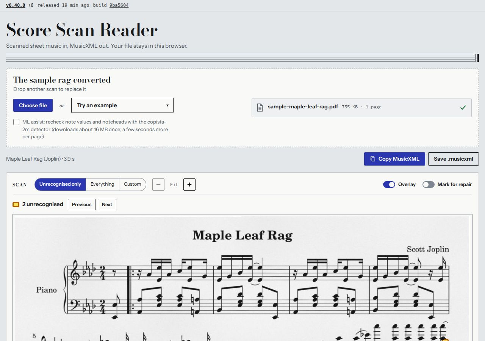
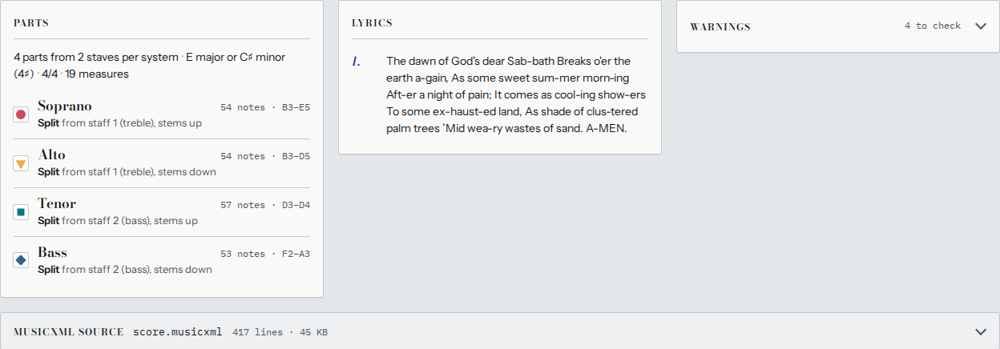
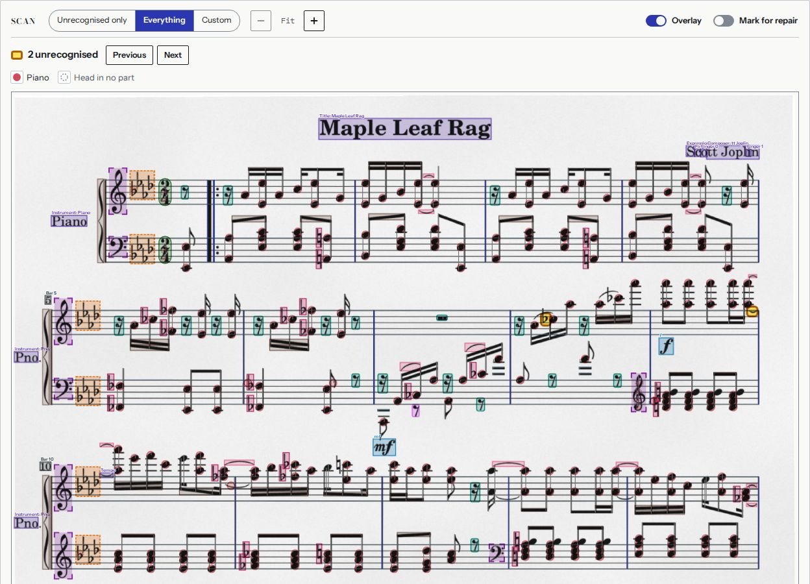
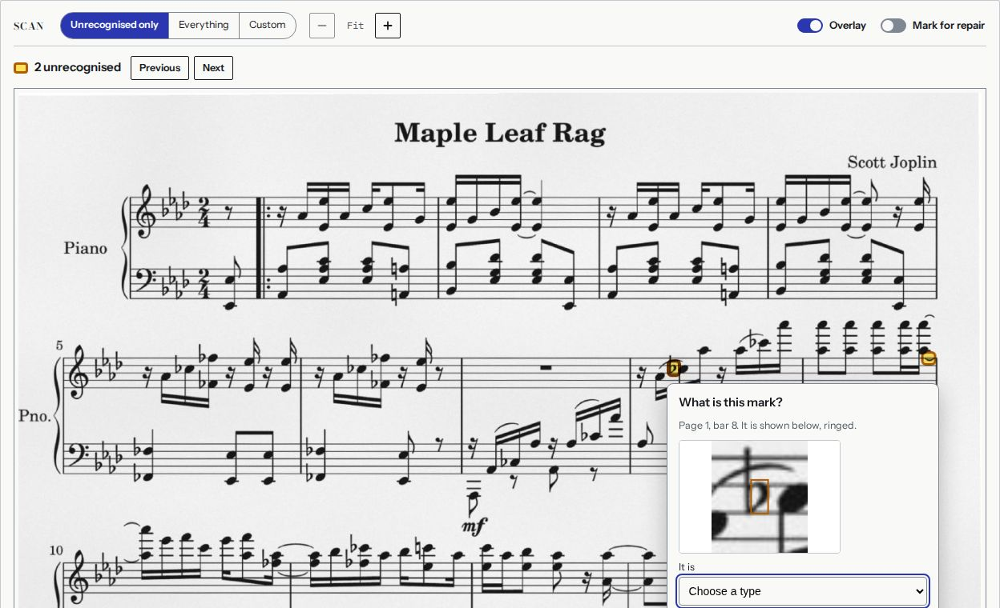
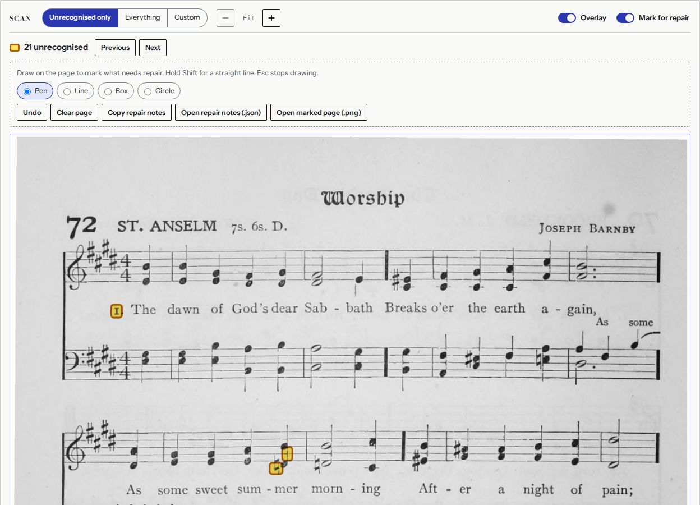
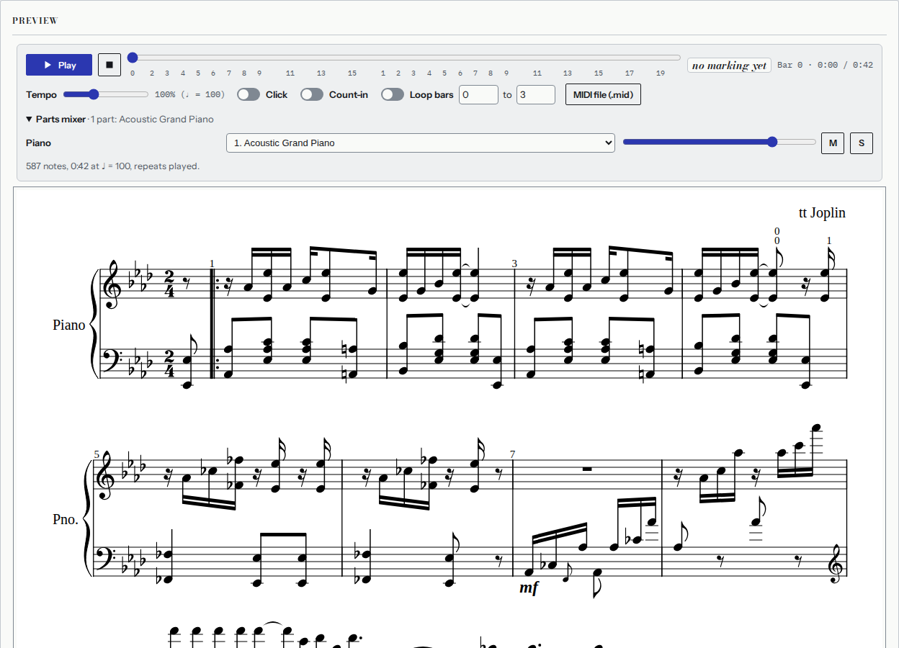

# Score Scan Reader: user guide

Score Scan Reader turns scanned sheet music into **MusicXML 4.0**, the format notation programs
(MuseScore, Dorico, Sibelius, Finale, Noteflight and others) open and edit. You give it a scanned
PDF or a photo of a page; it reads the staves, notes, rests, signatures, marks and lyrics, splits
the voices into parts, shows you what it read on top of the scan, and gives you the MusicXML to
copy or save. It can also play the result back.

**Open it:** <https://pension-plan.github.io/score-scan-reader/app/>

**Your file stays in your browser.** The page reads the scan on your own computer: nothing is
uploaded, there is no account, and the result exists only in the page until you copy or save it.
Text recognition (OCR) and the optional ML detector also run in the page; they download their model
files the first time and your browser keeps them.

Check the result against the scan before you rely on it: no music reader gets every mark right, and
the page shows you where it was unsure.

## 1. Give it a scan

- **Drop** a PDF, PNG or JPG anywhere on the page, or press **Choose file**. A PDF can have up to
  40 pages (longer ones are read up to page 40, and the result says so). Several files at once (PDFs
  and images) are read as one score, in name order.
- Or pick an **example** from *Try an example*: the Maple Leaf Rag (piano) and the St. Anselm hymn
  (four voices with lyrics) to start, then 19 more real and synthetic scans. The rag is converted
  when the page opens.
- The progress bar shows each stage (rendering the page, cleaning up the scan, staves, notes,
  lyrics, parts, MusicXML). A long PDF is read page by page; each page appears in the page strip as
  soon as it is read, with how long is left. **Stop after this page** ends the reading early: the
  result covers the pages read so far.
- On a slow connection the notes are shown first and the lyrics, titles and other text are filled in
  when the text reader has downloaded; the page says *Lyrics, titles and text are still being read*
  meanwhile.
- **ML assist** (off by default) rechecks note values and noteheads with the copista-2m detector, a
  small neural network. It downloads about 16 MB once and adds a few seconds per page.

Scans work best at 200–400 dpi, upright, one page per image. Sideways or upside-down pages are
turned, a photographed or curled page is straightened, and a two-page book spread is read as its
left page, then its right page. Very faint, blurred or low-resolution copies are read less well.

## 2. The result

- **Copy MusicXML** puts the whole file on the clipboard; **Save .musicxml** saves it (inside some
  embedded viewers it opens in a new tab instead, from where you can save it).
- **Parts** lists the parts with their note counts and ranges, and says where each came from
  (*Split from staff 1 (treble), stems up*, *Kept whole: piano grand staff*, …). Closed-score SATB
  is split into Soprano, Alto, Tenor and Bass; piano and organ staves stay together as one part;
  named parts keep their printed names.
- **Lyrics** lists the verses read under the notes.
- **Warnings** lists what the reader guessed or repaired (a clef it could not read, bars that did
  not add up and were filled or cut, an unread time signature inferred from the bars, …). Each one is
  worth a look.
- **MusicXML source** shows the file itself, with line numbers.
- **Preview** draws the score from the MusicXML (the first measures of a long score; *Draw every
  measure* draws the rest).

### Stanzas printed below the music

Hymns often print the later verses as a block of text under the music. These are read and kept in
the MusicXML as text. When the page finds such stanzas, the Lyrics panel offers **Set the stanzas
printed below the music as verses**: tick it to have them set under the notes as verses 2, 3, …
(the score is rebuilt in a moment; the page is not read again).

## 3. The Scan panel

The scan is shown with what the reader found drawn over it. Use the zoom buttons (− Fit +), the page
strip or the arrows to move between pages, and **Overlay** to hide the drawing.

Three views:

- **Unrecognised only** (the default): just the ink the reader could not explain, outlined in amber,
  with a count. **Previous** / **Next** (or the P and N keys) step through them.
- **Everything**: every note head (coloured and shaped by the part it went to), rest, clef, key and
  time signature, barline, beam, accidental, dot, tie and slur, dynamic, hairpin, articulation,
  text (title, composer, tempo, instrument names, lyrics), bar number, fingering, pedal mark and
  rehearsal mark, each labelled.
- **Custom**: choose which of those layers to show.

The page remembers your view, layers and zoom.

### Labelling unrecognised marks

Click (or press Enter on) an amber mark to say what it is: a note head, a rest, an accidental, a dot,
a clef, a signature, a dynamic, an articulation, a slur or tie, text, a bar number, *noise* (ignore
it) or something else. The popup shows the mark enlarged and says what your label will do.

- An **accidental**, **rest**, **augmentation dot** or **dynamic** you identify is **written into the
  MusicXML**: the accidental on the nearest note to its right, the rest at its place in the bar, the
  dot on the note to its left, the dynamic before the nearest note. The Parts panel says how many
  corrections were applied.
- **Noise** hides the mark.
- Every other type is kept as a label (it helps us improve the reader) but does not change the
  MusicXML.

Labels are remembered in this browser for that file, so they are there again when you reopen it.
**Copy labelled examples (JSON)** copies your labels with image crops, if you want to send them to
us.

### Mark for repair

Switch on **Mark for repair** to draw on the scan where the result is wrong, for yourself or to
report it: **Pen**, **Line** (or hold Shift), **Box** and **Circle**; **Undo** (Ctrl/⌘+Z), **Clear
page**; Esc stops drawing. Each mark is numbered in a list where you can type a note (*missed chord
note*). **Copy repair notes**
and **Open repair notes (.json)** give the marks as text; **Open marked page (.png)** gives the page
with your marks drawn on it. Marks for repair do not change the MusicXML.

## 4. Playback

The Preview has a player:

- **Play** / pause (or the Space bar), **stop** (back to the start), and a position bar with bar
  numbers; click a bar in the preview to play from there. The dynamic in force is shown as it plays.
- **Tempo** (from the tempo marking when one was read, otherwise ♩ = 100), a **Click**, a
  **Count-in**, and **Loop bars** from … to ….
- **Parts mixer**: a General MIDI instrument for each part (chosen from the part name: voices sing,
  piano plays piano, a flute is a flute), volume, mute (M) and solo (S). Drum parts play on the drum
  kit (channel 10), each drum on its own sound.
- Repeats, first and second endings, D.C. and D.S. are followed; dynamics, hairpins, accents,
  staccato and fermatas shape the sound.
- **MIDI file (.mid)** saves what you hear (instruments, tempo, dynamics) as a standard MIDI file.

The instrument sounds are sampled and download the first time you press Play.

## 5. What it reads

| | |
|---|---|
| Staves and systems | Five-line staves (also faint, broken or dashed ones), one-line percussion staves, braces and brackets, systems across pages, page and system breaks |
| Clefs | Treble, bass, alto/tenor (C clefs), treble 8vb for tenor parts, percussion; clef changes |
| Keys and meters | Key signatures (and changes, courtesy keys), time signatures (numbers, common and cut time, changes mid-piece), pickup bars |
| Notes and rests | Whole to 64th notes, dots and double dots, beams, flags, chords and seconds, stems, ledger lines, triplets and other tuplets, grace and cue notes, multi-bar rests |
| Accidentals | Sharps, flats, naturals, double sharps and flats, courtesy (parenthesised) accidentals |
| Voices and parts | Two voices on a staff split into parts (SATB, SSAA, TTBB, divisi), piano and organ kept whole, part names read from the page |
| Structure | Repeat signs, first/second endings (voltas), D.C., D.S., segno, coda, Fine, double and final barlines |
| Expression | Dynamics (ppp–fff, sfz and others), hairpins, articulations (staccato, accent, tenuto, marcato, …), fermatas, ottava lines (8va, 8vb, 15ma), ties and slurs |
| Text | Title, subtitle, composer, lyricist, arranger, tempo words and metronome marks, expression text, instrument names, chord symbols, bar numbers, rehearsal marks, fingering, pedal marks |
| Lyrics | Several verses, syllables and hyphens, melismas and extender lines, elisions, verse numbers; English and German, with French, Spanish, Italian and Czech read again where accents are seen; stanzas printed below the music |
| Percussion | Percussion clef staves (drum set and one-line), x-shaped heads (hi-hat, cymbals), written as unpitched drum notes |

How well each symbol and layout is read, on clean and worn scans, is measured on a test suite of
engraved scores and listed in the [coverage report](COVERAGE.md). Measured for release v0.40
(8 November 2026), reading lyrics as the app does:

| Test set | Score | Pitch | Duration | Rests | Lyrics | Parts |
|---|---|---|---|---|---|---|
| Benchmark: 20 hymns, songs and piano pieces (8 real scans) | 0.959 | 0.957 | 0.932 | 0.852 | 0.934 | 0.995 |
| … its real scans only | 0.937 | | | | | |
| Challenge set: 365 hard cases (worn copies, phone photos, dense layouts, lyrics in several languages) | 0.949 | 0.939 | 0.905 | 0.811 | 0.951 | 0.980 |
| Coverage suite: 312 scans of engraved items, one feature each | 0.930 | 0.910 | 0.838 | 0.750 | 0.977 | 0.970 |

The score (0–1) weighs pitch 30 %, duration 20 %, parts 20 %, lyrics 20 % and a valid file 10 %.
Every output is valid MusicXML, and no test item crashes the reader.

## 6. Known limits

- **Handwritten music** is not supported; printed (engraved or typeset) music only.
- **Worn, blurred and low-resolution copies** lose the most: thin stems, beams and dots fade, and
  note values and pitches suffer. 200–400 dpi scans of clean copies read best.
- **Dense piano writing** (many voices, cross-staff beams, tuplets inside tuplets) and **orchestral
  scores** with many staves read less reliably than hymns, songs and piano pieces.
- **Lyrics** in languages other than English and German are read with less confidence; lyrics on
  a badly worn scan may be partly missing.
- Ornaments (trills, turns, mordents), tremolos, arpeggios and glissandi are not yet written to the
  MusicXML; some are shown as unrecognised.
- Text the reader cannot place (footnotes, copyright lines) is kept as text, not music.
- The [coverage report](COVERAGE.md) lists what is supported, partial or not yet read, symbol by
  symbol.

## 7. Questions and feedback

The source code, issues and releases are at
<https://github.com/pension-plan/score-scan-reader>. Every release is listed there with its changes;
the converter's own *What's new* (at the bottom of the app) lists the latest ones. The
[design document](SDD.md) explains how the reader works.
